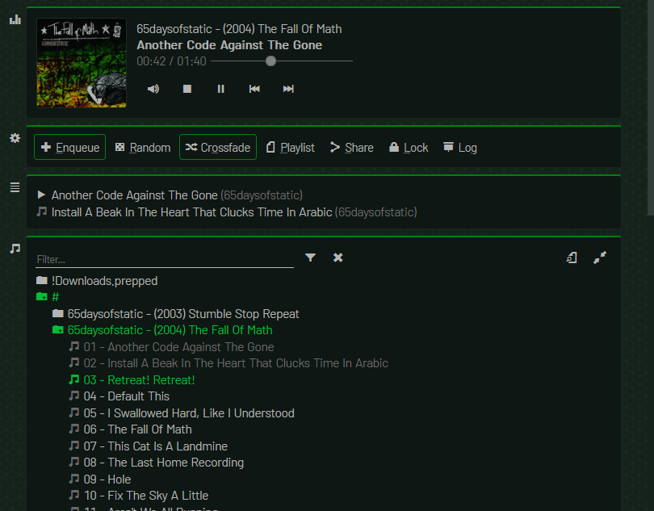
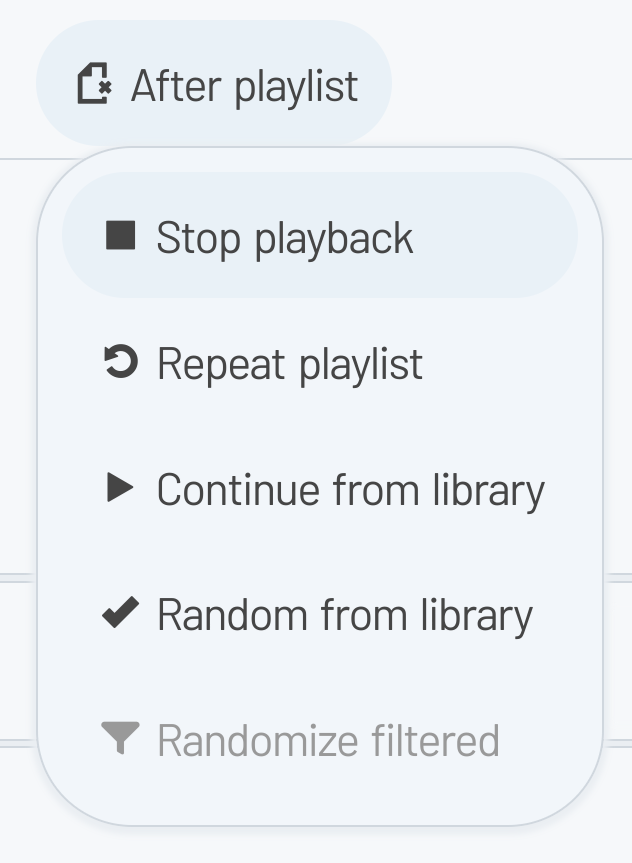
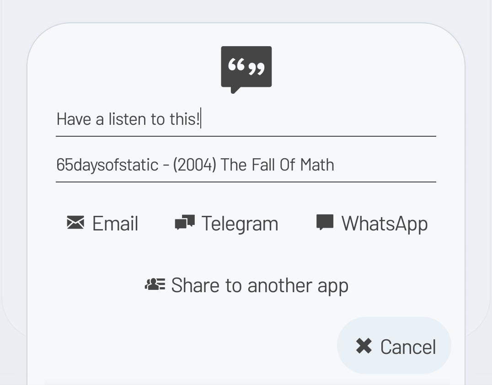

[Overview](#overview) • [Hotkeys](#list-of-hotkeys) • [Installation](#installation) • [Security](#security-file-operations) • [Credits](#credits)
# Music Folder Player
by ltGuillaume: [Codeberg](https://codeberg.org/ltguillaume) | [GitHub](https://github.com/ltguillaume) | [Buy me a beer](https://coff.ee/ltguillaume) 🍺

An elegant HTML5 web folder player for parties and/or private music collections, with a playlist system that all players should have had. It does not use a database (so it's alway up-to-date), but can easily handle folders with 25,000 songs or more. It has no dependencies other than PHP and installation costs less than 2 minutes. The design should be fully responsive on CSS3-compatible browsers.



## Overview

#### Player
- Click on cover image to zoom (300x300px, again for full size)
- Click on current song or folder name to find it in the library
- Right-click Volume to mute
- Right-click Next to skip current artist

#### Options
- Enqueue: Click on songs in the library to add songs to the end of the playlist, instead of playing them (next). Right-click to suggest a random song to enqueue.
- Random: pick the next song randomly from the upcoming songs (songs added using "Play next" take precedence)
	- Right-click Random to shuffle upcoming songs (songs added using "Play next" will stay in place)
- Crossfade: start playing the next song 10s before ending the current and fade out the current song
- Password lock the playlist and playlist controls (allowing only Enqueue, Play/pause and Share)
	- Tip: use [OpenKiosk](http://openkiosk.mozdevgroup.com) and disable _Set Inactive Terminal_
- Do not add previously played songs to playlist (optional)

#### Playlist



- Click on a song to play directly
- Drag and drop to change the order, drag to bin to remove
- Right-click a song to find it in the library
- Choose how to continue when the playlist is exhausted:
	- Stop playback
	- Repeat the playlist
	- Continue from the last played song's position in the library
	- Randomly select unplayed songs from the (filtered) library
- Playlist and configuration will be saved to the browser's Local Storage if possible
- Load/save online playlists (can be disabled)
- Import/export playlists from/to a local file

#### Library
- Rebuilds the tree of a specified folder, showing only files with supported extensions
- Use arrow keys to traverse the library tree, Enter to play/enqueue, or Shift-Enter to play next/add folder
- Click a song to play (or enqueue when "Enqueue" mode is enabled)
- Clicking on a song will never clear the playlist (looking at you, ol' Winamp)
- Play next: right-click (long-press) a song to play it next ("Play next" songs will play in "FIFO" order)
- Right-click a folder to add all its songs to the playlist
- Prevents adding a song if it's already queued up (unless "Play next" is used)
- Sports a library (instant) filter to quickly find songs

#### Sharing



- Download a song or zipped folder
- Share a song, folder or playlist link (library features/options will be disabled)
- Share links directly to email, social media or use your device's native share options (optional)

#### Themes
- Define your own subset of the available themes and variants in `music.ini`
- <span style="background-color:#1a1a1a;color:#b4b4b4">&nbsp;Black&nbsp;</span>, <span style="background-color:#141a21;color:#b4b4b4">&nbsp;blue&nbsp;</span>, <span style="background-color:#14221a;color:#b4b4b4">&nbsp;green&nbsp;</span>, <span style="background-color:#23272c;color:#b4b4b4">&nbsp;gray&nbsp;</span> and <span style="background-color:#eaeef2;color:#444">&nbsp;light&nbsp;</span> color themes
- Can be mixed with variants (see `music.theme.css`):
	- Material-like rounded UI and compact retro UI
	- Colorize <span style="background-color:#1a6eac;color:#fff">&nbsp;hovered buttons&nbsp;</span>
	- <span style="color:#1d91f0">Blue</span>, <span style="color:#00bd35">green</span>, <span style="color:#eb6600">orange</span> and <span style="color:#e0006f">pink</span> focus colors
	- Indicate enabled options by colored borders instead of checkmarks
	- Decorative top border for main elements and bottom border for hovered buttons

#### Translations
- Currently includes Chinese, English, Dutch, Hungarian, Portuguese and Spanish
- Instructions for creating new translations can be found in the [Wiki](https://codeberg.org/ltguillaume/music-folder-player/wiki/Translations)

## List of hotkeys
A list of all hotkeys can be found in the [Wiki](https://codeberg.org/ltguillaume/music-folder-player/wiki/List-of-hotkeys).

## Installation
You can have a test setup running within 2 minutes. For all the details, check the [Wiki](https://codeberg.org/ltguillaume/music-folder-player/wiki).

## Security: file operations
`music.php` serves the library script and the download, playlist download, playlist save and playlist delete endpoints. All of these are confined to the configured `root` and `playlistdir` from `music(.defaults).ini`:

- Download paths are normalized and must resolve inside `root`; absolute paths, `..` traversal (including backslash and encoded variants), empty paths and paths pointing at the server's own files are rejected with a `400` and a generic message. Errors never contain absolute server paths. (When `root` is configured as an absolute path, the one absolute prefix that stays inside it is accepted, since clients send exactly that.)
- Playlist names must be a single plain path segment: no path separators, no `.`/`..`, no leading dot, no control characters. They are rejected on download, save and delete.
- Deleting a playlist unlinks exactly that one playlist file. User input is never used as a wildcard pattern, so a name like `Mix*` cannot remove other files.
- Playlist contents are re-validated when downloaded: entries that leave `root` make the request fail instead of leaking files, and the resulting archive stores relative paths only.

### Verifying locally
The repository ships a self-contained test that sets up a temporary installation (library, playlist directory and an `outside` directory that must stay unreachable), starts PHP's built-in server and exercises both legitimate and malicious requests:

```
php tests/path-security-test.php
```

The test check covers legitimate downloads, playlist listings, sub-library and single-song views as well as playlist save, overwrite (with its timestamped backup) and delete. Every malicious request must be rejected and must leave the library, playlist directory and `outside` directory byte-for-byte unchanged. A second installation with an absolute `root` is spun up as well, to confirm that its configured prefix keeps working while every other absolute path is refused. Folder and playlist downloads are archived with `7z` (Windows) or `zip` (elsewhere); when neither is installed those four checks are reported as `SKIP` and the rest still runs. Exit code `0` means everything passed.

## Credits
- Some concepts of this project are based on the excellent [HTML5 Music Player](https://github.com/GM-Script-Writer-62850/HTML5-Music-Player) by [GM-Script-Writer-62850](https://github.com/GM-Script-Writer-62850)
- The [Barlow font](https://github.com/jpt/barlow) (Regular and Semi Condensed Regular) is used for text
- The [Foundation icon font](https://zurb.com/playground/foundation-icon-fonts-3) is used for all icons
- Album art placeholder is based on a [design by CmdRobot](http://fav.me/d7kpm65)