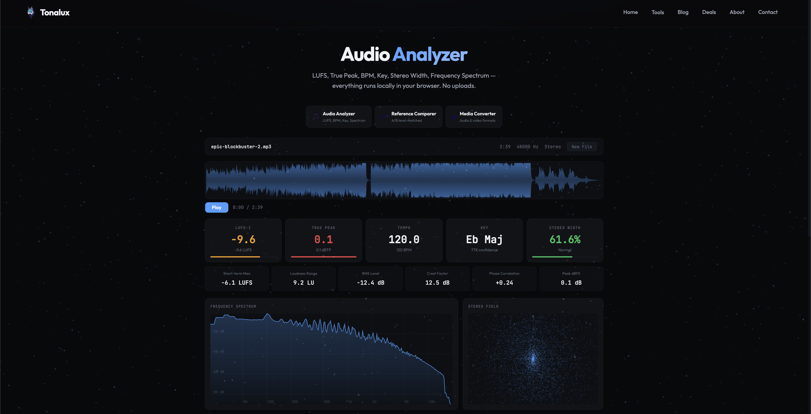

# Tonalux Audio Analyzer

Professional grade audio analysis that runs entirely in your browser. No uploads, no accounts, no server. Your audio never leaves your device.

**[Try it live on tonalux.org](https://tonalux.org/analyzer.html)**



## What it does

Drop any audio file and get instant measurements:

- **LUFS Metering** — Integrated, short-term, momentary loudness and LRA (EBU R128 / ITU-R BS.1770)
- **True Peak** — Intersample peak detection via 4x Catmull-Rom interpolation (dBTP)
- **BPM Detection** — Onset envelope analysis with autocorrelation
- **Key Detection** — Chromagram + Krumhansl-Kessler profiling (major and minor)
- **Stereo Analysis** — Width, phase correlation, and real-time goniometer
- **Frequency Spectrum** — 256-band log-spaced FFT with real-time overlay during playback
- **Streaming Targets** — Loudness comparison for Spotify, Apple Music, YouTube, Tidal, Amazon, Deezer
- **Audio Playback** — Click-to-seek waveform, spacebar play/pause

All DSP runs in a Web Worker off the main thread. Optional enhanced BPM/key detection via [Essentia.js](https://mtg.github.io/essentia.js/) (loaded from CDN, graceful fallback).

## Quickstart

```bash
git clone https://github.com/Exenye/tonalux-analyzer.git
cd tonalux-analyzer
python3 -m http.server 8080
```

Open [http://localhost:8080](http://localhost:8080). Any static HTTP server works (Python, Node, VS Code Live Server, etc.).

Supports MP3, WAV, FLAC, AAC, and OGG.

## How the DSP works

The signal processing pipeline implements broadcast standard loudness measurement:

1. **K-Weighting** — Two-stage biquad filter (high-shelf at 1681 Hz + high-pass at 38 Hz) per ITU-R BS.1770
2. **Gated LUFS** — 400ms blocks with absolute gate (-70 LKFS) and relative gate (-10 LU below ungated mean)
3. **FFT** — Cooley-Tukey radix-2 in-place, 8192-point for 5.9 Hz/bin resolution at 48kHz
4. **True Peak** — 4x oversampled Catmull-Rom interpolation to catch intersample peaks
5. **Key Detection** — Chromagram extracted from FFT bins mapped to pitch classes, correlated against Krumhansl-Kessler major/minor profiles via Pearson correlation

## Project structure

```
index.html          — HTML markup (121 lines)
css/analyzer.css    — Styles, dark theme, responsive (250 lines)
js/analyzer.js      — App logic, playback, canvas rendering (776 lines)
js/worker.js        — DSP Web Worker: FFT, LUFS, peaks, BPM, key (443 lines)
```

No build step. No bundler. No dependencies.

## Browser support

Chrome/Edge 66+ · Firefox 76+ · Safari 14.1+

## Part of Tonalux

This analyzer is part of [Tonalux](https://tonalux.org), a platform for audio professionals. Check out the other tools at [tonalux.org](https://tonalux.org).

## License

MIT — see [LICENSE](LICENSE).
