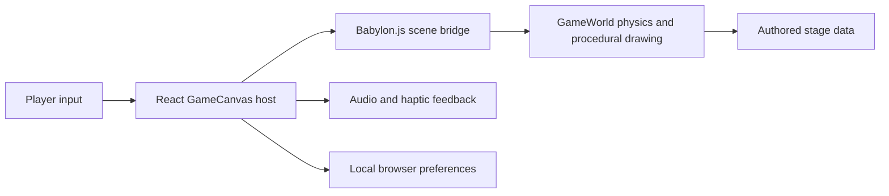

# Bytebound: Meadow Run

> An original retro-style browser platformer built for keyboard and landscape mobile play.

[](https://github.com/vincenzo-afk/MARIO/actions/workflows/ci.yml)
[](LICENSE)
[](https://www.typescriptlang.org/)

[Play locally](#getting-started) · [Report a bug](https://github.com/vincenzo-afk/MARIO/issues/new/choose) · [Request a feature](https://github.com/vincenzo-afk/MARIO/issues/new/choose) · [Contributing](CONTRIBUTING.md)

---

## <a name="table-of-contents"></a>Table of Contents

- [About](#about)
- [Technology](#technology)
- [Getting Started](#getting-started)
- [How to Play](#how-to-play)
- [Project Structure](#project-structure)
- [Features and Scope](#features-and-scope)
- [Testing and Quality Checks](#testing-and-quality-checks)
- [Deployment](#deployment)
- [Contributing](#contributing)
- [Security](#security)
- [License](#license)
- [Acknowledgments](#acknowledgments)

---

## <a name="about"></a>About

Bytebound: Meadow Run is an original, route-based platformer. Players run through three handcrafted stages, collect signal shards, activate relay checkpoints, avoid hazards, and reach a portal to advance. The project uses procedural canvas art instead of imported character or sprite assets, so the complete visual language remains original to the game.

The game is browser-first and designed for both desktop and touch input. Phones use a landscape play surface with a rotate-to-play handoff in portrait. The install manifest requests fullscreen and landscape presentation for supported mobile web-app environments.

| Area | Implemented behavior |
| --- | --- |
| Gameplay | Movement, jumping, enemies, hazards, checkpoints, shards, portals, lives, respawn, and stage completion |
| Level content | Three authored stages: **Meadow Relay**, **Copper Canopy**, and **Dawn Switchyard** |
| Controls | Arrow keys or WASD with Space on desktop; pointer-safe touch controls on mobile |
| Accessibility and preferences | Left-handed touch layout, sound/music toggle, haptic-feedback toggle, and local preference persistence |
| Audio | Original looping music and procedural retro cues for jumps, collecting, stomps, checkpoints, damage, and finishing |

### Architecture



The gameplay core is intentionally framework-agnostic. `GameWorld.ts` owns movement, collision, progress, and canvas drawing; `scene.ts` is the Babylon.js bridge; and `GameCanvas.tsx` manages input, touch controls, settings, audio, haptics, fullscreen behavior, and UI.

---

## <a name="technology"></a>Technology

| Category | Verified technology |
| --- | --- |
| Frontend | React 19.2.1, TypeScript 5.6.3, Tailwind CSS 4.1.14 |
| Game rendering | Babylon.js Core 9.20.0 with a dynamic canvas texture |
| Build tooling | Vite 7.1.7 and esbuild 0.25.0 |
| Runtime and package manager | Node.js with pnpm 10.4.1 as declared in `package.json` |
| Mobile web | Web App Manifest with fullscreen and landscape preferences |
| Storage | Browser `localStorage` for player settings |

The project has no database, no user authentication, and no required API key for local play.

---

## <a name="getting-started"></a>Getting Started

### Prerequisites

Install a current Node.js release and enable Corepack so the declared pnpm version can be used. No environment file is required to run the game locally.

### Installation

```bash
git clone https://github.com/vincenzo-afk/MARIO.git
cd MARIO
corepack enable
pnpm install
pnpm dev
```

Vite starts the development server using the repository’s `dev` script. Open the local address printed in the terminal. For landscape mobile testing, open the same address on a phone or use browser device emulation and rotate to landscape.

### Available commands

| Command | Purpose |
| --- | --- |
| `pnpm dev` | Start the Vite development server |
| `pnpm check` | Run TypeScript without emitting files |
| `pnpm build` | Build the browser bundle and production server entry |
| `pnpm start` | Run the built production server |
| `pnpm preview` | Preview the Vite build locally |
| `pnpm format` | Format project files with Prettier |

---

## <a name="how-to-play"></a>How to Play

Start a route from the in-game prompt. Move, jump, collect signal shards, and use relay checkpoints to preserve progress through a stage. Reach the portal at the end of each stage to continue.

| Action | Desktop | Touch |
| --- | --- | --- |
| Move left | Left Arrow or `A` | Left movement button |
| Move right | Right Arrow or `D` | Right movement button |
| Jump | Up Arrow, `W`, or Space | JUMP button |
| Pause or resume | `P` or Escape | Pause control in the top bar |
| Restart a stage | `R` | Restart control in the top bar |
| Configure touch, sound, and haptics | Settings control in the top bar | Settings control in the top bar |

On mobile, rotate into landscape before starting. The game uses a full-viewport layout on supported browsers; fullscreen is requested after starting and remains optional where a browser does not permit it.

---

## <a name="project-structure"></a>Project Structure

```text
.
├── client/
│   ├── public/
│   │   └── manifest.json          # Fullscreen, landscape mobile-web metadata
│   └── src/
│       ├── components/GameCanvas.tsx  # React host, HUD, settings, input, touch controls
│       ├── game/
│       │   ├── GameWorld.ts       # Physics, progression, procedural canvas drawing
│       │   ├── audio.ts           # Music and procedural retro audio cues
│       │   ├── levelData.ts       # Three authored stage definitions
│       │   ├── scene.ts           # Babylon.js dynamic-texture bridge
│       │   └── types.ts           # Shared semantic game contracts
│       └── pages/Home.tsx         # Full-screen game route
├── mobile/README.md               # Native-shell boundary notes
├── .github/                       # CI, issue forms, and PR template
├── CONTRIBUTING.md
├── SECURITY.md
└── package.json
```

---

## <a name="features-and-scope"></a>Features and Scope

### Current capabilities

- ✅ Three authored side-scrolling stages with checkpoints, hazards, enemies, shards, moving platforms, and portal progression.
- ✅ Forgiving movement behavior through jump buffering and coyote time.
- ✅ Original procedural pixel-inspired art and original retro audio.
- ✅ Keyboard controls, mobile touch controls, left-handed layout, and local settings persistence.
- ✅ Full-viewport landscape mobile experience with portrait rotation guidance and optional fullscreen.
- ✅ Sound/music and haptic-feedback preferences that apply immediately.

### Scope boundaries

The repository currently ships a browser-first game. It includes mobile-web install metadata, but it does not include a separate native iOS or Android project. The game does not have a published public roadmap; proposed work should be opened as a focused GitHub issue.

---

## <a name="testing-and-quality-checks"></a>Testing and Quality Checks

Run the available static and production validations before opening a pull request.

```bash
pnpm check
pnpm build
```

The repository includes a GitHub Actions workflow named **CI** that runs these two commands on pushes and pull requests targeting `main`. No standalone automated test command or coverage report is currently defined; manually exercise the affected keyboard, touch, orientation, audio, and settings behavior when changing gameplay-facing code.

---

## <a name="deployment"></a>Deployment

Create a production bundle with the declared build command, then run the production server entry.

```bash
pnpm build
pnpm start
```

The Vite client bundle is produced for the browser, and the project’s production server serves the built output. The repository does not contain a provider-specific deployment configuration, so choose a hosting environment that supports a Node.js process and static browser assets.

---

## <a name="contributing"></a>Contributing

Contributions are welcome through focused issues and pull requests. Read [CONTRIBUTING.md](CONTRIBUTING.md) for setup, validation, branch, and pull-request guidance. Participation is governed by the [Code of Conduct](CODE_OF_CONDUCT.md).

---

## <a name="security"></a>Security

For responsible vulnerability reporting, read [SECURITY.md](SECURITY.md). Do not publish suspected security problems in public issue threads.

---

## <a name="license"></a>License

This project is licensed under the [MIT License](LICENSE). Copyright © 2026 BHARANI KUMAR S.

---

## <a name="acknowledgments"></a>Acknowledgments

Bytebound: Meadow Run uses [React](https://react.dev/), [TypeScript](https://www.typescriptlang.org/), [Vite](https://vite.dev/), and [Babylon.js](https://www.babylonjs.com/). The game’s characters, procedural art direction, stages, and audio are original to this project.

<p align="right"><a href="#bytebound-meadow-run">Back to top</a></p>
