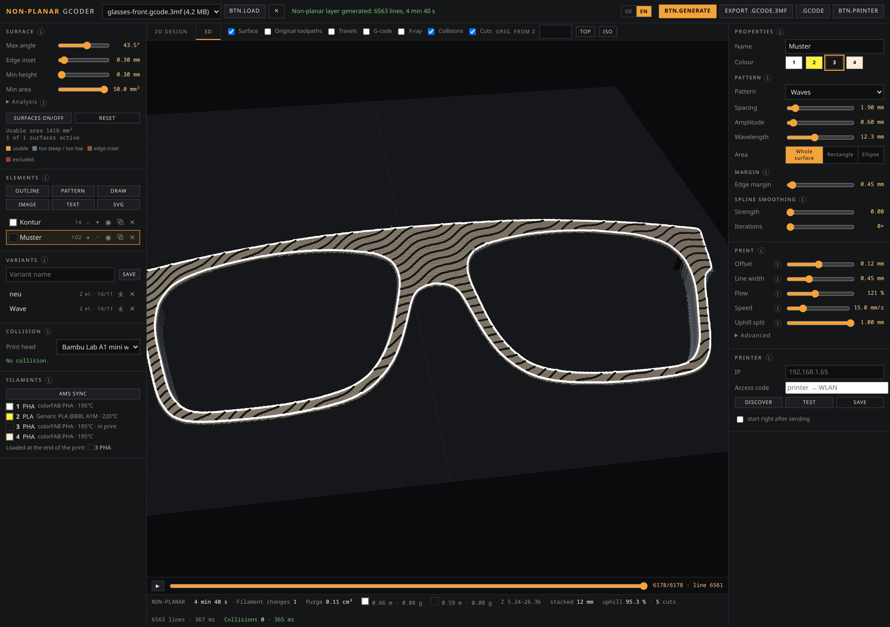
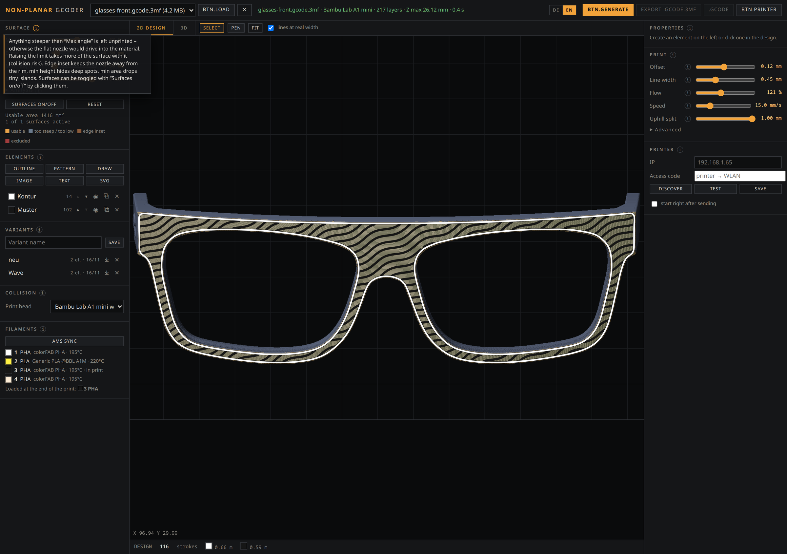

<p align="center">
  
</p>

# Impasto

**Add one non-planar decoration layer to an already sliced Bambu Studio print – in the browser.**

You keep slicing in Bambu Studio. This app takes the finished `.gcode` or `.gcode.3mf`, works out
the surface of the part, lets you draw decoration on it (outlines, patterns, text, images, SVG)
and writes a merged `.gcode.3mf` back with a single extra non-planar pass before the end G-code.
The nozzle follows the real surface while it prints the decoration – over the rim of a lens, along
a curved housing, across a tapered front.

The example part in the screenshots is a compostable eyewear front from
[augenrahmen.de](https://augenrahmen.de) (100 % PHA, printed in Berlin) – see
[Made with augenrahmen](#made-with-augenrahmen).

> **Self-hosted, no public instance.** This repository is the complete app. There is no hosted
> service to try – start it locally (see [Quick start](#quick-start)) or on a machine in your own
> network. The printer connection (FTPS/MQTT, AMS) is designed for a Bambu printer in LAN mode and
> needs to reach it directly.

<p align="center">
  
</p>

## The name

*Impasto* is the painter's term for paint laid on so thickly that the brushstroke stands up from
the canvas. That is what this tool adds to a print: a raised pass of its own – one bead of
filament wide, in up to four colours – on a surface that is already finished. It decorates and
labels the surface; it does not plan the print.

## Why

Full non-planar slicing (PancakeSlicer / Orca) put the whole print into a different engine and the
result did not meet the print quality of Bambu Studio. This tool takes the opposite route: the
model is sliced perfectly normally, and only the last decorative pass is generated non-planar.
The original G-code stays untouched; the new block is inserted right before the printer's end
G-code.

## Not the only non-planar route

Non-planar printing has more than one answer, and this is not the only solution for it. Full
non-planar slicers – PancakeSlicer, Orca-based forks – go deeper: they take the model, plan the
toolpaths themselves and can lay whole layers along a curved surface. This tool does not. It takes
a print that is already sliced and adds one pass on top of it.

What it does with the technique is different in kind: it uses non-planar motion to **design and
label a surface – visually and structurally**. A raised line, a pattern, a photo, a word, in up to
four colours, exactly where you put it. The result is relief you can see and feel, not a different
toolpath for the part.

So the two do not replace each other, and neither is the better one in general. A full non-planar
slicer decides how the whole part is printed and can curve a surface; it cannot take your finished
Bambu slice, read the surface out of it and put a multi-colour pattern on the front of it. That is
the one thing this tool is built for.

## Features

- **Surface analysis from above** – height map of the topmost toolpaths on a 0.1 mm grid, angle
  from the smoothed height, nozzle radius, edge inset, minimum height and minimum area. Surfaces
  can be included and excluded with a click.
- **Elements**: contour, patterns (lines, grid, waves, zigzag, curls, circles, spiral, dots,
  diamonds), freehand drawing, images (PNG/JPG, k-means colour separation), text and SVG.
  Move, scale, rotate, recolour; crop and tile images and text.
- **Order is the stack** – the element list is the stacking order. Where two elements overlap, the
  lower one is printed first; everything that does not overlap is free, so all elements of a colour
  are planned as one chain and a colour only comes back when an overlap needs it. Every line is
  placed on what is really below it at print time, including partial overlaps, crossings within an
  element and loops of a single stroke: `z = max(surface + offset, line below + bead)`.
- **Uphill printing** – each section between two travels is printed so the nozzle climbs the
  surface instead of pushing material down. Strokes are split at crests (zigzag hysteresis, 3-point
  median against layer steps); threshold `0` splits every wave. Stats show the uphill share, the
  number of cuts and the descent that is left. Closed outlines start at their lowest point, so the
  cuts sit on real turns; a short, steep stub at a stroke end is printed on its own, uphill.
- **Short travels** – all sections of a colour are ordered as one chain so that the nozzle leaves a
  section where the next one starts. Every gap is a retract, a hop and a prime (that is where the
  oozing shows), so a section may also be printed the other way round when that saves more travel
  than the downhill costs: `dir_travel_weight` says how many millimetres of travel one millimetre of
  downhill is worth (`0` = shortest ways only, default `10`, `20` ≈ uphill only). The order comes from
  nearest-neighbour seeds, 2-opt/Or-opt and a few double-bridge kicks with a fixed seed (groups of
  up to 9 sections are solved exactly), so the same design always gives the same G-code.
- **Less oozing at the gaps** – a retract wipes back along the line just printed (Bambu's
  `wipe_distance`, retracting while it moves), optional coasting stops the feed shortly before a
  line that ends in a retract, travels up to `short_travel` stay down without a retract, and the hop
  over already printed lines is only `hop_bead`.
- **Speed that fits the bead** – each segment is capped by the filament's volumetric limit at the
  real gap under the nozzle (a thick bead on a slope needs more material) and slows down in tight
  curves (`curve_radius`, `curve_min`).
- **Warp allowance** – a warped part sits higher than the G-code says. `warp_ends` lifts the nozzle
  towards the ends of each part (square of the distance from the middle along its long axis),
  `warp_edge` right at the outline; measure the gap after a print and enter it.
- **Touch-off (experimental)** – instead of guessing the warp, the nozzle touches the real part.
  The A1/A1 mini sense nozzle contact with the eddy-current force sensor in the toolhead; Bambu's
  own start G-code taps the plate with `G380 S3` at 140 °C. The layer is printed in cells
  (`probe_region`, default 40 mm), each cell starts with a guarded `G380 S3` move down to a flat,
  solid spot near its middle, and `G92 Z<planned surface>` re-zeroes Z there – every later Z of the
  cell is then relative to the real part. The printer cannot report measured heights over LAN, so
  this works without reading anything back. Optional cool-down for the touch (`probe_temp`, default
  140 °C, `M109` waits for cooling on Bambu firmware) with re-heating at the purge chute. Off by
  default; test it with a hand on the printer.
- **Slope compensation** – on a slope the flat nozzle face touches its highest point, so the line
  centre gets a thicker bead (tip radius × tan angle). `slope_comp` takes a share of that back while
  the face keeps 0.03 mm clearance; the flow follows the smaller gap.
- **Nozzle follows the surface** – the height is the maximum of the surface under the whole nozzle
  disc plus the offset (`z_offset` can be negative). Crossings are lifted over lines already
  printed, the flow can adapt to the real gap under the nozzle.
- **Filament changes from the printer profile** – the profile's own `change_filament_gcode` is
  expanded with the Bambu purge matrix and multiplier; the colour order is chosen for minimal
  purge.
- **Optional collision check** – every move is tested against the printed model using the print
  head envelopes from PancakeSlicer (nozzle cone, heater sock, ducts, gantry). Hit boxes turn red
  in the x-ray view. The A1 mini presets include a variant **without the part cooling fan**.
- **3D preview with playback** – surface, original toolpaths, generated G-code, travels, cuts,
  collision markers, x-ray print head and the G-code view follow the slider. *Downhill* colours the
  lines red that still run downhill, *Retracts* shows every retract (dots) and the wipe/coast moves.
- **Key figures per export** – every export and every send appends its numbers (travel, retracts,
  uphill share, wipe, coast, time, filament, parameters) to `data/<id>/exports.jsonl`, so a print
  result can be matched with the settings that produced it.
- **Send to the printer, AMS only** – uploads the merged `.gcode.3mf` over FTPS and starts it over
  MQTT. Every filament used by the object *and* by the non-planar layer is mapped to an AMS tray
  (colour + material first, a free tray after that). If a filament cannot be mapped or the AMS
  cannot be read, the start is refused instead of falling back to the external spool.
- **English / German UI** with a language selector; every explanation lives in a hover tooltip
  (the small `i`) instead of taking space next to the controls.

<p align="center">
  
</p>

## Quick start

```bash
git clone https://github.com/3p1cball-code/impasto.git
cd impasto
python3 -m venv .venv
.venv/bin/pip install -r requirements.txt
.venv/bin/python -m impasto.server
```

Open <http://localhost:6868>.

| Variable | Default | Meaning |
|---|---|---|
| `IMPASTO_PORT` | `6868` | HTTP port |
| `IMPASTO_HOST` | `0.0.0.0` | bind address (use `127.0.0.1` for local only) |
| `IMPASTO_DATA` | `./data` | uploads, designs, variants, printer settings |

Run it as a systemd user service (autostart, restart on failure):

```bash
cp deploy/impasto.service ~/.config/systemd/user/
systemctl --user daemon-reload
systemctl --user enable --now impasto
```

`deploy/deploy.sh user@host` syncs the working tree to another machine, installs the
requirements and restarts the service there.

## Workflow

1. **Load** a Bambu `.gcode` or a sliced `.gcode.3mf` (plate selector for multi-plate files).
2. **Surface** – set the maximum angle, edge inset, minimum height and area. The drawing shows
   what is usable (amber), too steep or too low (grey) and excluded (red). Refine σ and the nozzle
   radius under *Analysis*.
3. **Elements** – add contours, patterns, drawings, images, text or SVG. Everything is clipped to
   the usable surface live; each element has its own margin and optional spline smoothing.
4. **Generate** – the G-code block is built, the optional collision check runs, and the 3D view
   opens with playback. The status bar shows time, filament changes, purge, uphill share, cuts and
   collisions.
5. **Export** as `.gcode.3mf` or `.gcode`, or **send** it to the printer (AMS only).

Designs and named variants are stored per file and plate, so switching between ideas is one click.
`Ctrl+Z` / `Ctrl+Y` undo and redo.

## How it works

**Surface.** The parser replays the sliced file and collects the uppermost extrusion segments.
A height map is built from above (0.1 mm cells), invalid cells are filled, the height is smoothed
(σ) and the angle is derived from the gradient. Steeper than the limit, deeper than the minimum
height or smaller than the minimum area is not printable. The nozzle radius is handled as a disc
maximum, so the nozzle cannot clip a step.

**Decoration layer.** Every element becomes polylines in bed coordinates. They are clipped to the
mask (minus the element margin), optionally smoothed and simplified, then resampled at `step`.
`z` is the maximum of the surface under the nozzle disc plus `z_offset`, raised over previously
printed non-planar lines (sampled right before each line is printed) and over earlier parts of the
same line where it crosses itself, with ramps across crossings. Extrusion is derived from the line
width and the real gap below the nozzle; speed is capped per segment by the filament's maximum
volumetric speed at that gap and reduced in tight curves. Travels lift `hop` over the highest
surface point and `hop_bead` over the highest printed line along their path; short ones stay down.

**Uphill split.** For each section the surface height along the path is examined. A local crest
that runs more than the split threshold against the print direction cuts the section; both halves
are printed from their lower end. A 3-point median ignores single layer steps, `dir_end_len` keeps
cuts away from stroke ends and `dir_cap` optionally limits the number of parts. Every cut is
written to the G-code as `; impasto section …`, drawn as a dot in the 2D view and as a cross in 3D.

**Order.** Overlapping sections of different elements get a precedence (lower element first, within
line width + nozzle radius + 0.05 mm). Colour batches are formed from that: a colour is printed as
one run of all its elements whose predecessors are done; it comes back only when an overlap
genuinely blocks it, so a "white – colour – white" stack yields three batches. Among the colours
that may go next the one that can be finished completely wins, and the already loaded filament is
kept while it still has work (no needless change). Without an explicit `color_order` the colour
sequence is the one with the least total purge, estimated from the Bambu flush matrix with
`purge_factor` and `min_purge` and starting from the loaded filament (asymmetric matrix, so order
matters; solved exactly up to 10 colours). An explicit `color_order` is used instead, keeping only
the slots that occur in the design (duplicates and unknown slots dropped) and appending the rest in
slot order. `toolchanges`, `purge_mm3`, `batches` and `precedences` report exactly what the G-code
does. Inside a batch the sections are chained by a nearest-neighbour pass plus 2-opt and or-opt
(`impasto/tour.py`), every move checked against the precedences. The cost of a chain is
`travel + weight × downhill`, so a long way round is only taken when it buys less descent than
`dir_travel_weight` allows. The resulting travel is shown as *travel* in the stats bar, the cuts as
`; impasto section …` in the G-code.

**Merge.** The block is inserted before Bambu's end G-code. The header, layer count, time estimate,
`M73` progress, the end Z and – for `.gcode.3mf` – `slice_info.config`, `plate_<n>.json` and the
MD5 are updated. Filament use is added to the totals.

## Printer

Tested with a Bambu Lab A1 mini in LAN mode. Enter IP and access code under *Printer* (the access
code is stored Fernet-encrypted in the data directory, never in the repository). *Discover* scans
the network for port 990; *Test* checks FTPS and MQTT and reads the serial number.

Starting a job uses the AMS only. The mapping is resolved before the upload:

| Job filament | AMS tray |
|---|---|
| same colour and material | that tray |
| same colour | that tray (flagged) |
| same material | that tray (flagged) |
| anything else | a free tray, never the external spool |
| fewer trays than filaments | the job is not started |

Nothing is sent to a printer that is currently printing; the app only uploads and, when enabled,
starts a new job.

## Collision check

`impasto/heads/` contains 56 head envelopes from [PancakeSlicer](https://github.com/zimengxiong/PancakeSlicer)
(AGPL-3.0) as axis-aligned boxes in the nozzle-tip frame. The check samples each move, tests the
nozzle cone and the boxes against the height map and reports the hit boxes and depth. The profiles
are conservative envelopes, not exact CAD. Three derived presets drop the part cooling fan and its
duct for machines where that assembly is removed
(`tools/make_head_variants.py`).

## HTTP API

The web UI is a static app on top of a small FastAPI backend. Useful endpoints:

```
POST /api/upload                              upload .gcode / .gcode.3mf
GET  /api/job/{id}?plate=2                    metadata, filaments, defaults
GET  /api/job/{id}/grid?plate=2&sigma=&tip=   height map + mask (binary)
POST /api/job/{id}/generate?plate=2           {params, paths, head} -> stats, moves, gcode
GET  /api/job/{id}/export?plate=2&fmt=3mf     merged download
GET  /api/job/{id}/exports?plate=2            key figures of earlier exports / sends
POST /api/job/{id}/send?plate=2               {start} -> FTPS upload (+ MQTT start)
GET  /api/printer/status                      state, progress, AMS trays
```

The `X-Impasto-Lang: de|en` header selects the language of backend messages.

## Limits

- One decoration pass on top of a normal print – not a general non-planar slicer.
- Stacking samples the printed lines at the line centre; two lines that overlap by less than
  ~0.4 line width are not lifted onto each other.
- The warp allowance is a model (a bow along the long axis, a ramp at the edge), not a measurement.
- Touch-off corrects one offset per cell (piecewise constant) and relies on undocumented firmware
  behaviour (`G380 S3` stops on contact, `G92 Z` re-zeroes); if a touch finds nothing within
  `probe_depth`, Z is set anyway and the cell sits up to that much too low.
- On slopes the flat nozzle sits higher than the tip by `nozzle radius × tan(angle)`; `z_offset`
  and the gap flow compensate for that. Very steep areas are excluded by the angle limit.
- The head envelopes are simplified boxes; the collision check is a warning, not a guarantee.
- Printer integration is targeted at Bambu Lab (FTPS + MQTT + AMS). Other printers can still use
  the exported G-code if they understand it.

## Tests

```bash
.venv/bin/python -m pytest -q
```

The tests cover the G-code parser, height map, path/pattern generation, uphill splitting, the
ordering with precedences, colour order (least purge, explicit `color_order`), colour batches and
their `; FilamentChangeGCodeStart`/`End` blocks, wipe/coasting, self-crossings, curve speed, warp
allowance, touch-off, slope compensation, the
collision check, filament changes (rendered against a real Bambu tool-change block), the AMS
mapping and the HTTP API (including send and variants). The UI has no test runner; a JS syntax
check and manual browser runs are used instead.

## Made with augenrahmen

The glasses front in the screenshots is not a demo model. It is the front of a compostable eyewear
frame from **augenrahmen**: designed and 3D-printed in Berlin from 100 % PHA, a biopolymer produced
by microorganisms that breaks down completely in soil and water. Every frame is made to order –
size, pattern and colour per customer.

The non-planar wave is exactly the kind of decoration this tool adds to that part: printed onto the
real surface, not painted on.

- Website: <https://augenrahmen.de>
- Instagram: <https://www.instagram.com/augenrahmen/>

### Videos

- [Non-Planar 3D Printing – how I approached it](https://www.youtube.com/watch?v=vDr6Q35kM5s) (N3RD_ kram on YouTube)
- [Instagram reel 1](https://www.instagram.com/augenrahmen/reel/Dfx2g6cMkXK/)
- [Instagram reel 2](https://www.instagram.com/augenrahmen/reel/Dfzas7_MIjh/)

## License

AGPL-3.0-or-later. The head profiles in `impasto/heads/` come from PancakeSlicer (AGPL-3.0) and
require the same license; see `impasto/heads/ATTRIBUTION.md`. three.js is MIT, FastAPI, uvicorn,
numpy, scipy and paho-mqtt keep their own licenses.

No telemetry, no accounts, no cloud: uploads, designs and printer settings stay in `data/`.
