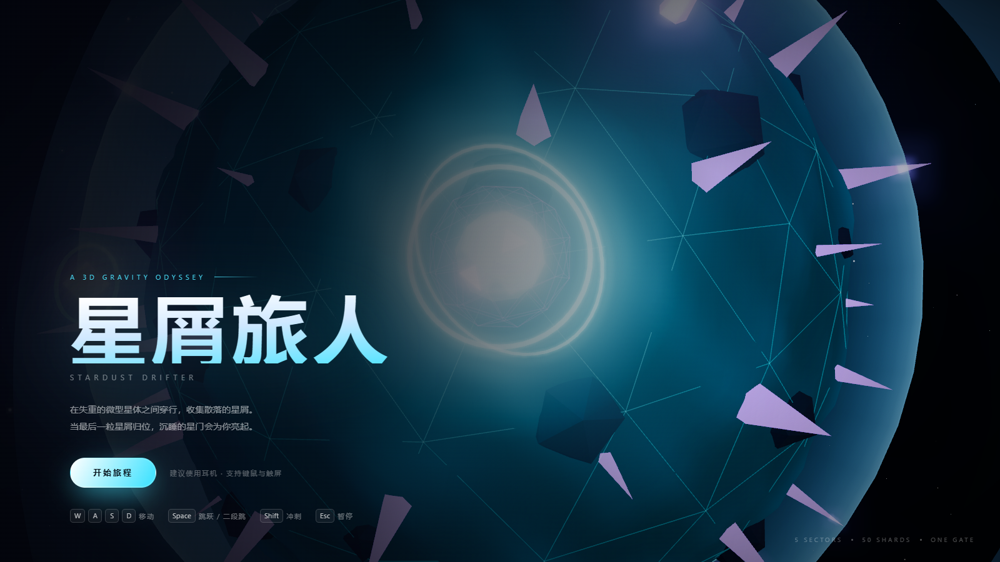
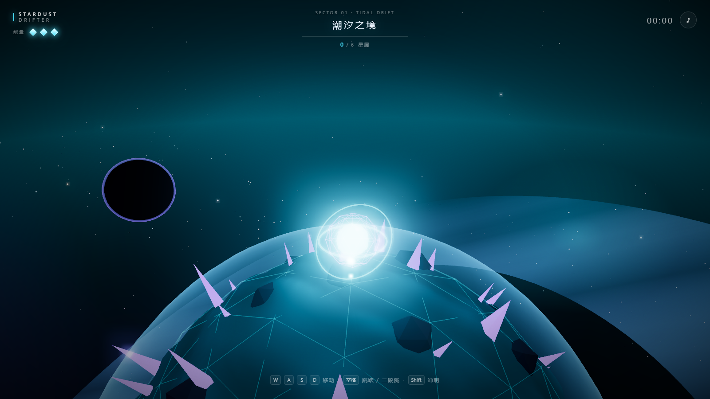

<div align="center">

<h1>✨ 星屑旅人 · Stardust Drifter</h1>

<h3>没有地板，只有星球。<br/><sub>No floor. Just planets.</sub></h3>

<p>
  
  
  
  
  
</p>

<p>
  <a href="#zh"><b>中文</b></a> ｜ <a href="#en">English</a>
</p>

<p>
  <a href="https://zzuli-ljz.github.io/stardust-drifter/"><b>▶ 在线游玩 Play in Browser</b></a>
  &nbsp;·&nbsp;
  <a href="#quickstart">⬇ 本地运行</a>
</p>

</div>

<p align="center">
  
  
</p>

---

<a id="zh"></a>

## 🪐 这是什么？

你是一枚迷路的星屑。

宇宙没有地板，只有一颗颗悬在深空里的小小星球。于是你决定沿着它们的表面一路跑下去——跑过一百八十度的白昼与黑夜，跳过星球之间的虚空，把散落的星屑一颗颗捡回来，点亮沉睡的星门。

**《星屑旅人》是一款能直接在浏览器里跑起来的 3D 球面重力冒险游戏。** 它的重力永远指向你脚下那颗星球的球心，所以"下"是一个随时会变的方向——你绕着星球跑一圈，会亲眼看到太阳从头顶升起、又从背后落下。

> 如果你玩过《超级马里奥银河》，会立刻懂那种手感：**重力是弯的，世界是圆的，而风景永远在转。**

整个游戏只有 5.6 MB（含引擎），不联网、不安装、不请求任何外部资源——**双击 `index.html` 就能玩**。所有音乐、音效、星空、星球地形、晶簇、星云，全部由代码在运行时生成，仓库里没有一个音频文件、没有一张贴图。

## 🎯 一句话玩法

> 捡星屑 → 点亮星门 → 跃迁到下一个星域 → 重复五次 → 回家。

- 每个星域散落着 **星屑**（6 → 14 颗，逐关递增），靠近会被自动吸附。
- 收集进度会**点亮整颗星球的能量网格**，越捡越亮（真的能看见星球在发光）。
- 集齐后 **星门** 苏醒，走进光柱即可跃迁到下一片星域。
- 星球旁边挂着 **小卫星**——二段跳 + 冲刺跳上去，那里藏着额外星屑。
- 你有 **3 格能量**：撞荆棘、被暗影游魂追上、掉进虚空都会掉一格。掉光就重来这个星域。

**五大星域，五种情绪：**

| # | 星域 | Sector | 配色 |
| :--: | --- | --- | --- |
| 01 | 潮汐之境 | TIDAL DRIFT | 青蓝 × 电紫 |
| 02 | 绯红浮岛 | CRIMSON ISLES | 樱粉 × 暖橙 |
| 03 | 翡翠回廊 | EMERALD HALLS | 薄荷 × 冰蓝 |
| 04 | 琥珀熔炉 | AMBER FORGE | 琥珀 × 熔岩 |
| 05 | 深瞳之心 | THE DEEP EYE | 紫罗兰 × 霓虹 |

## 🎮 操作

| 操作 | 按键 |
| --- | --- |
| 移动（相机相对） | `W` `A` `S` `D` / 方向键 |
| 跳跃 / 二段跳 | `空格` |
| 冲刺（带 FOV 拉伸） | `Shift` |
| 暂停 | `Esc` |
| 静音 | `M` |

手机、平板等触屏设备会自动出现**虚拟摇杆**与跳跃 / 冲刺按钮，无需任何设置。

**小技巧：** 冲刺不只是加速——它是唯一能让你跨过星球之间缝隙的手段。跳起来，在空中按冲刺，你会飞得比想象中远。

## ⚙️ 技术细节（给好奇的人）

这不是一个 `import` 三个模型文件就完事的项目，几乎所有东西都是**算出来的**。

**球面重力物理** — 每帧取最近天体作为落脚点，重力方向 = 从天体球心指向你。角色用切平面坐标系做移动积分，跨星球时自动切换参考系并重新落地。你能在卫星上倒着走、在星球背面奔跑、从一颗星跳到另一颗星。

**全程序化世界** — 每个星球的半径、地形起伏、晶簇、岩石、荆棘、星屑、暗影、卫星位置全部由种子随机生成。同一关每次开局长得一样（可复现），但五个星域完全不同的配色、雾、星空密度会改变整体情绪。

**渲染管线** — HalfFloat + MSAA 渲染目标 → 自定义菲涅尔大气辉光 shader → UnrealBloom → ACES Filmic 色调映射。星云是体积噪声贴在球壳上，星空是单 Draw Call 的点精灵，银河带用密度函数铺出来。

**零资源音频** — 环境垫音是几个失谐正弦波叠慢速 LFO，收集音是五声音阶风铃（连击会一路升调），跳跃 / 冲刺 / 受击是噪声包络 + 滤波扫频。全部由 WebAudio 在运行时合成，**仓库里 0 个音频文件**。

**性能** — 晶簇 / 岩石 / 荆棘用 InstancedMesh 合批；粒子是单个 600 容量的 GPU 点精灵池，收集、跳跃、冲刺、受击特效共用一个 Draw Call；相机用指数阻尼跟随，掉帧时不抖；内置自适应画质，帧率低于阈值会自动降分辨率与辉光强度。

## 🧪 自动化测试

真机测试不靠"我觉得没问题"。仓库里带了两套基于 **Chrome DevTools 协议** 的端到端测试脚本，直接驱动真实浏览器。

**收集进度生命周期回归测试**（`tools/progress-test.mjs`）覆盖四种情形：

1. 正常收集一颗星屑 → 星球能量网格亮度、HUD 星屑计数与进度条、星门状态三者同步更新；
2. 未集齐时走进星门 → 不换关；
3. 重试本关 → 进度、HUD、亮度、星门全部归零，关卡对象不叠加；
4. 跃迁到下一关 → 新关从零开始，上一关亮度不残留。

额外验证掉入虚空只扣能量、不清空已收集进度，以及反复重建关卡时场景对象数不增长。

**完整流程冒烟测试**（`tools/cdp-test.mjs`）覆盖移动 → 跳跃 → 收集 → 星门 → 跃迁 → 通关结算。

```bash
npm run build            # 修改 src/ 后先重新打包 assets/game.js
npm run test:progress    # 收集进度生命周期回归测试
npm test                 # 完整流程冒烟测试
npm run test:all         # 两套都跑
```

两个脚本都会自带临时静态服务器，无需手动起 `http.server`；需要本机安装 Chrome 或 Edge（也可用 `CHROME_PATH` 指定）。当前状态：**全部通过，0 JS 错误。**

<a id="quickstart"></a>

## 🚀 快速开始

**方式一：直接玩（推荐）**

双击 `index.html`。就这样。不需要 Node，不需要 npm，不需要联网。

**方式二：在线玩**

<https://zzuli-ljz.github.io/stardust-drifter/>

**方式三：本地服务器**

```bash
npx serve .
# 或
python -m http.server 8123
```

## 🛠 开发

```bash
npm install          # 只装 three 与 esbuild
npm run build        # 重新打包 assets/game.js（单文件 IIFE）
npm run test:progress  # 收集进度生命周期回归测试
npm test             # 完整流程冒烟测试
```

调试参数：`index.html?auto` 跳过标题直接开局；`?sim` 自动行走（方便看摄像机与物理）。运行时可通过 `window.__game` 读取 `level`、`player`、`levelIndex`，并调用 `buildLevel` / `retryLevel` / `startGame` 做本地验证。

## 📁 项目结构

```
index.html            入口（双击即玩）
assets/game.js        打包产物，已内联 Three.js 全部依赖
styles/main.css       HUD / 标题 / 结算界面样式
src/
  main.js             状态机、相机、主循环、关卡流程、五套配色
  scene.js            渲染器、星空、星云、后期处理、自适应画质
  world.js            星球、卫星、星屑、荆棘、暗影、星门
  player.js           球面重力物理、拖尾彗星、受击与无敌帧
  fx.js               单 Draw Call 粒子池
  audio.js            WebAudio 程序化配乐与音效
  hud.js / input.js   HUD 与输入（键鼠 + 触屏摇杆）
tools/cdp-test.mjs    CDP 端到端冒烟测试
tools/progress-test.mjs  CDP 收集进度生命周期回归测试
preview/              截图
```

## 📄 License

MIT —— 随便玩、随便改、随便拿去交作业。

---

<a id="en"></a>

# ✨ Stardust Drifter

### No floor. Just planets.

*A 3D gravity-bending adventure that runs in your browser. Zero install, zero assets, one click.*

You are a stray shard of starlight.

There is no ground in this universe — only small planets hanging in the dark. So you decide to run along their surfaces: through a full 180° of day and night, across the void between worlds, gathering every scattered shard until the sleeping stargates wake up.

**Stardust Drifter is a 3D platformer where gravity always points at the center of whichever planet you're standing on.** That makes "down" a direction that changes as you move — run a full circle and you'll watch the sun rise over your head and set behind your back.

> If you've played *Super Mario Galaxy*, you already know the feeling: **gravity is curved, the world is round, and the view never stops turning.**

The whole game is ~5.6 MB including the engine. No network calls, no install, no external assets — **double-click `index.html` and you're playing.** Every star, sound, planet, crystal and nebula is generated by code at runtime. There is not a single audio file or texture in this repo.

## 🎯 The loop

> Collect shards → wake the stargate → warp to the next sector → five times → home.

- Each sector scatters **shards** (6 → 14, growing per level); get close and they snap to you automatically.
- Collecting **lights up the planet's energy grid** — the world literally gets brighter as you progress.
- Fill the meter and a **stargate** opens. Step into the beam to warp.
- Small **moons** orbit each planet — double-jump and dash onto them for bonus shards.
- You have **3 energy pips**. Thorns, shadow wraiths and the void all cost one. Lose them all and the sector restarts.

**Five sectors, five moods:**

| # | Sector | Palette |
| :--: | --- | --- |
| 01 | TIDAL DRIFT | cyan × electric violet |
| 02 | CRIMSON ISLES | sakura pink × warm amber |
| 03 | EMERALD HALLS | mint × ice blue |
| 04 | AMBER FORGE | amber × molten orange |
| 05 | THE DEEP EYE | violet × neon cyan |

## 🎮 Controls

| Action | Key |
| --- | --- |
| Move (camera-relative) | `W` `A` `S` `D` / arrows |
| Jump / double jump | `Space` |
| Dash (with FOV kick) | `Shift` |
| Pause | `Esc` |
| Mute | `M` |

On touch devices a virtual joystick plus jump and dash buttons appear automatically.

**Tip:** a dash isn't just speed — it's the only way to clear the gap between two planets. Jump, then dash mid-air, and you'll fly much further than you'd expect.

## ⚙️ Under the hood

Nothing here is a downloaded model. Almost everything is computed.

**Spherical gravity physics** — each frame the nearest body becomes your anchor and gravity points from its center to you. Movement is integrated in a tangent-plane frame, and crossing between bodies swaps the reference frame and re-lands you cleanly. You can run upside down on a moon, sprint across a planet's far side, and leap from one world to another.

**Fully procedural worlds** — radius, terrain displacement, crystals, rocks, thorns, shards, wraiths and moon orbits are all seed-generated. Each level looks the same every run (reproducible), while the five sectors get completely different palettes, fog and star density.

**Rendering** — HalfFloat + MSAA targets → custom fresnel atmosphere shader → UnrealBloom → ACES Filmic tone mapping. Nebulae are volumetric noise on shell geometry, the starfield is a single point-sprite draw call, and the galactic band is density-function scatter.

**Zero-asset audio** — the ambient pad is detuned sines with slow LFOs, shard pickups are a pentatonic chime that rises in pitch with your combo, and jumps/dashes/hits are noise envelopes through sweeping filters. All synthesized with WebAudio at runtime.

**Performance** — InstancedMesh for crystals, rocks and thorns; a single 600-capacity GPU point-sprite pool shared by every particle effect; exponentially damped camera follow; and an adaptive quality system that drops resolution and bloom strength when frame time slips.

## 🧪 Automated tests

Testing isn't "looks fine to me." The repo ships two end-to-end scripts built on the **Chrome DevTools Protocol** that drive a real browser.

**Collection-progress lifecycle regression test** (`tools/progress-test.mjs`) covers the four cases that used to drift apart:

1. collecting a shard → planet grid brightness, HUD counter/bar and gate state all update together;
2. walking into the gate before the set is complete → no level change;
3. retrying the level → progress, HUD, brightness and gate all reset, with no leftover level objects;
4. warping to the next level → the new level starts from zero and the previous level's brightness never bleeds through.

It also asserts that falling into the void only costs energy (never progress) and that repeated rebuilds don't grow the scene graph.

**Full-flow smoke test** (`tools/cdp-test.mjs`) covers move → jump → collect → gate → warp → victory.

```bash
npm run build            # rebuild assets/game.js after editing src/
npm run test:progress    # collection-progress lifecycle regression
npm test                 # full-flow smoke test
npm run test:all         # both
```

Both scripts spin up their own temporary static server, so there's no need to start `http.server` by hand. Chrome or Edge must be installed (`CHROME_PATH` overrides the lookup). Status: **all passing, 0 JS errors.**

## 🚀 Run it

**Play instantly:** double-click `index.html` — no Node, no npm, no internet.

**Or online:** <https://zzuli-ljz.github.io/stardust-drifter/>

**Or via a local server:**

```bash
npx serve .
# or
python -m http.server 8123
```

## 🛠 Development

```bash
npm install          # three + esbuild, nothing else
npm run build        # rebuild assets/game.js (single IIFE bundle)
npm run test:progress  # collection-progress lifecycle regression
npm test             # full-flow CDP smoke test
```

Debug flags: `index.html?auto` skips the title screen; `?sim` auto-walks for camera and physics inspection. At runtime, `window.__game` exposes `level`, `player`, `levelIndex`, plus `buildLevel` / `retryLevel` / `startGame` for local verification.

## 📄 License

MIT — play it, fork it, hand it in as homework.

<div align="center">
<br/>
<sub>Made with Three.js, a lot of math, and no small amount of caffeine.</sub>
</div>
