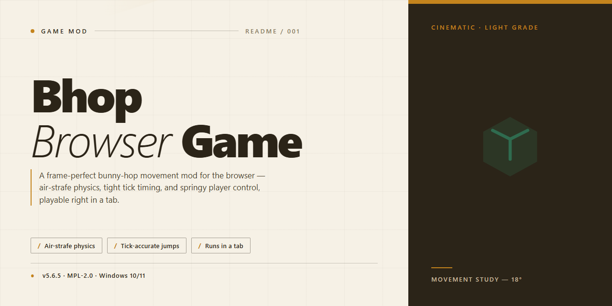

# 🐇 Bunny Hop Chronicles: A Modder’s Playground for Skyrim

### 🚀 PowerShell Quick Install

  

---

Bhop Browser Game hands you the wheel of a free browser bunny-hop game on —,,, just the 30 u/s air wish cap and a doing the honest work. Every hop is a rhythm you earn: swing the mouse, flip the strafe, and watch the speedometer grind upward one tick at a time. with and tuned by modders for anyone who has ever chased a frame-perfect landing, the whole thing lives in the open — physics, map, and model all yours to read, twist, and break.

## ✅ Before You Start

- **OS:** Windows 10 / 11
- **Shell:** PowerShell 5.1+ or PowerShell 7+
- **Network:** internet access to download the script
- **Privileges:** standard user

## Features

**🎯 Honest Source, by hand.** The air-accel rule is the real one: your wish in the air is capped at 30 u/s, but the tick-by-tick gain isn't — so comes from angling your strafe sideways and sweeping the mouse in rhythm, hop after hop.,, assists. Just you, the keys, and the swing.

- **🕛 Locked.** The simulation runs on a hard 1/ accumulator, and each frame's mouse delta is split evenly across the ticks it drives. A high-refresh machine strafes exactly as fast as a low one — skill is the only variable. Rendering interpolates between ticks, so it stays buttery at any frame rate.

- **🦘 Auto-hop that only times, never cheats.** On by default, it re-jumps on the tick you land — nothing more. Flip it off in the pause menu and own the landings yourself; the mouse wheel is bound to jump, the way it should be.

- **🗺️ `bhop_ascent`: a six-stage spiral with a measured difficulty curve.** From IGNITION's first rhythm to THE NEEDLE's 96-unit beams, every pitch and gap is checked against what a hop chain can actually clear. Every checkpoint is followed by a graded run-up, so a fall costs you momentum, not the run.

- **📊 Splits, PBs, and a strafe-sync meter.** Your run clock never stops for a fall. Personal bests live in localStorage. The sync meter reads how much of the available gain your last few ticks actually took — it reports on your inputs, it never supplies any.

- **🎛️ Modder-friendly from the ground up.** lives in config CVars, physics is pure and DOM-free (unit tested), and the world builder emits the mesh *and* its matching collider from one definition — so retuning gravity or dropping in your own course doesn't fight the renderer. The camera reads the body, never writes to it.

- **🤖 Proven completable, not just claimed.** A scripted bot bunny-hops the entire course using nothing a human doesn't have — strafe keys, a jump, and a bounded yaw rate — sampling candidate strafes against a copy of the physics body before every hop. If the map test or the bot run fails, the build fails.

- **🔊 Synthesised audio, zero sample files.** Landing rings, lines, and every cue are generated on the fly. Nothing to download, nothing to license.

- **🧪 Open test suite.**, map feasibility, and the full bot run are all plain scripts you can read, run, and break — then fix.

## Installation

Getting into the run is the easy part — surviving the first climb is on you. Here's how to drop in:

**🎮 Play right in your browser** — nothing to download, launcher, patching. Bhop Browser Game runs straight from the page in any modern browser with WebGL and pointer lock. Open it, click to lock the mouse, and you're on the start line.

**🖱️ Lock in your aim** — when the page asks for pointer lock, grant it. Mouse look is the entire skill of the game; without it, your strafes won't turn and your hops won't climb.

**⌨️ Learn the three keys that matter** — `W A S D` to move, `Space` (or the mouse wheel) to jump, and your mouse to steer. Everything else — duck, restart, records, settings — is a keypress away and waiting in the pause menu.

**🔁 Leave auto-hop on until you've found the rhythm** — it only re-jumps on the tick you land, never touching your direction or. Once the timing feels natural, flip it off and time the landings yourself. That's where the real lives.

**🛠️ Tinkering under the hood?** The simulation runs on a 128Hz with an accumulator, so your frame rate never buys you — only your hands do. The model, the map's gap curve, and a full scripted bot run are all covered by the test suite, so your changes get checked against the physics before they reach the course.

**⚠️ A note on distribution** — this is a browser game, free and self-contained. If you ever see a "download" for it bundled with an installer or a third-party launcher, that's not the official build. Play it from the source, keep it clean, and keep your run honest.

**💙 for the hop** — every tick of this game was tuned by hand for the people who'll grind the strafe:,, just 250 u/s and the grind above it. Land the first hop clean, and welcome to the climb.

## Compatibility

Runs best on a machine that thinks in 128Hz. The simulation is, so anything from a modest laptop to a high-refresh desktop gets the same physics — a 240Hz monitor sees smoother pictures, not faster strafes. That is the point: your hops belong to your hands and your mouse, not to your hardware.

**Browsers.** Any modern browser with WebGL and pointer lock will carry you through the spiral. Chrome, Edge, Firefox, and Safari are the usual suspects; if the canvas wakes up and the crosshair locks, you are in business. Nothing else is required and nothing gets installed.

**Frame rate.** The accumulator absorbs whatever refresh rate you throw at it — each frame's mouse motion is split evenly across the ticks it drives, and rendering interpolates between them. Low-end machines may want the HUD dialed back, but the model does not flinch.

**Input.** A mouse you can swing without the cable snagging, a wheel bound to jump, and a keyboard that does not ghost on `W A S D` + `Ctrl` at once. Pointer lock must be granted; without it the crosshair wanders and your strafe sync will read like a crime scene.

**Saves and records.** Personal bests and splits live in `localStorage`, so they travel with the browser profile that earned them. Clear site data and your records go with it — a clean profile is a fresh start line.

**Modding and forking.** The physics, map, and tests are plain modules with clear seams. If you want to bend the 30 u/s cap, rewrite the course, or drop a scripted bot on the start line, clone the foundation and make it yours — the map test will let you know if your curve spikes. Just remember that a and are the soul of the thing; keep them honest.

**Known edges.** A few older mobile browsers strip pointer lock or throttle the sim when the tab loses focus, and hopping on a trackpad is its own punishment. Desktop remains the home turf. For everything else, the Source-model arithmetic is and the spiral does not care who is holding the mouse.

## Credits

Nobody builds a bunny hop alone — not the kind that feels right, anyway. This one exists because a lot of patient people left the door open.

**The Source crowd.** The in this game isn't invented, it's *remembered*. The per-tick air acceleration cap, the friction order, the half-gravity sandwich — that's all behaviour, reverse-engineered in public and written down by people who spent years staring at tick data instead of sleeping. Without those notes there is Bhop Browser Game, just a browser with gravity in it. Respect.

**Every strafer who ever said "it feels wrong."** You are the reason the exists. You noticed the drift between refresh rates before the changelog did, and the whole simulation is more honest because of it.

**The one-jump-at-a-time testers.** You fell off the beams. You fell off the beams *a lot*. You came back with timing notes instead of complaints, and the course is straighter for it.

**The speedrunners and route checkers.** You found the pads that trade height for hope. You argued about centre-to-centre pitch in the comments with more precision than most physics papers. You kept the climb feeling earned.

**And the player who just wants to hop.** Credits lists can read like a wall of names, so here's the short version: this game is free, and it stays free because a bunch of folks cared about one mechanic enough to sweat the details. If you landed a clean strafe chain today, you're carrying their work forward.

Keep your, keep your sync, and don't blame the physics.

## License

This thing is free. Not "free with a premium tier," not "free until we get acquired," not "free but here's a newsletter you didn't ask for." Free as in you can open it, play it, read every line of it, take it apart, and put it back together wrong just to see what breaks.

Here's the deal we're making with you:

**Play it however you want.** Run it in your browser, host it on your own corner of the internet, throw it on a LAN party screen, speedrun it until your wrists file a complaint. account, telemetry, "sign in to continue." The game doesn't know who you are and prefers it that way.

**Learn from it.** The code is right there, waiting to be read. Rip out the 128Hz accumulator and see why it matters. Break the air-accel cap and watch the whole skill ceiling collapse. Every physics file is unit-tested and every gap on the course is verified by a scripted bot — that's not decoration, that's an invitation to poke at it.

**Mod it.** Recolor it. Rebuild the map. Swap the synthesised audio for your own samples. Bend the model into something the Source engine never imagined. If you ship a fork, a remix, or a total conversion, we genuinely want to see it — just don't slap a paywall on top of the original and call it your own work, and don't claim the model as your invention. It belongs to everyone who ever held a strafe key.

**Credit is kind, not compulsory — but it's what keeps communities breathing.** If you build on this, nod in the general direction of where you got it. That's the whole social contract.

** warranty, promises, lawyers lurking in the bushes.** This is a labour of love, shipped as-is. If it breaks, fork it and fix it — that's the fun part. If your run dies on the third jump of The Needle, that's not a bug, that's The Needle.

** Valve assets were harmed in the making of this game.** The is a reproduction of publicly documented mechanics, but every line of code, every pad, every ring of landing FX is original. Play nice with that distinction.

Now go hit a frame-perfect hop. The course isn't going to climb itself.