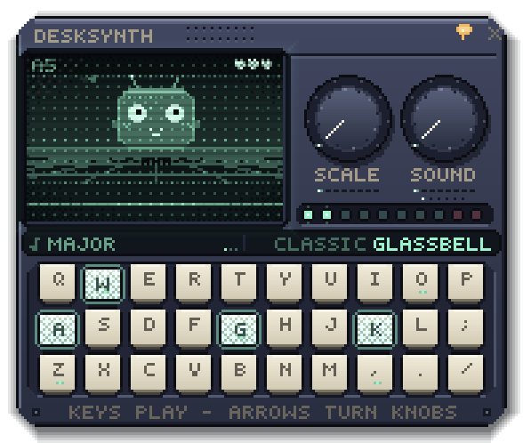
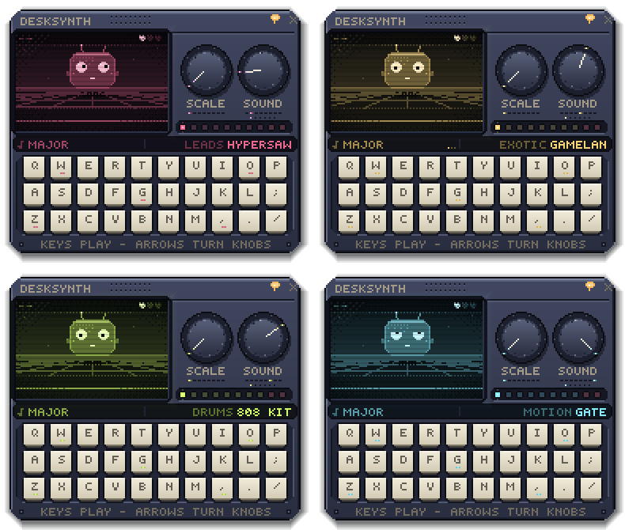
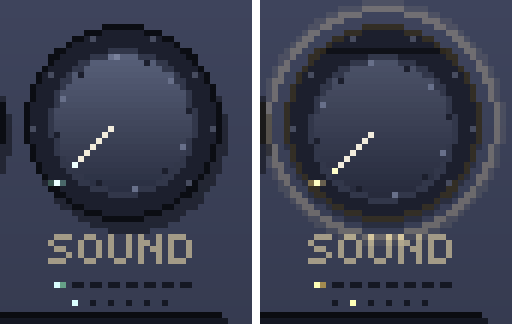
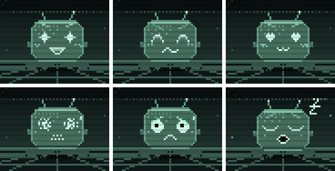

# DeskSynth

A pixel pocket synth that lives on your desktop. Every key is locked to a scale,
so you can mash the keyboard while a build runs and it still sounds like music.
There's a creature in the display that watches what you play.

<p align="center">
  
</p>

- **30 keys, no wrong notes.** Every key is a degree of the current scale.
- **48 sounds in 8 packs**, synthesized from scratch — no samples anywhere.
- **8 scales** sharing one tonic, so switching is a mode change, not a key change.
- **A pet** with a mood state machine that reads how you play.
- **A 196 × 166 pixel window** that sits above everything, pinnable, in three
  sizes, with feedback on every single input.

## Run it

```bash
git clone https://github.com/SvenSchmid/desksynth.git
cd desksynth
npm install
npm start
```

Node 18+ and about 100 MB of disk for the Electron binary. macOS, Windows and
Linux should all work; it has only been exercised on macOS.

## Playing it

| Input | What it does |
| --- | --- |
| `Q`–`P`, `A`–`;`, `Z`–`/` | 30 keys, bottom-left is the lowest scale degree |
| `←` / `→` | Turn the SCALE knob |
| `↑` / `↓` | Turn the SOUND knob — picks the sound pack |
| `Tab` / `Shift`+`Tab` | Next / previous sound inside the pack |
| `Space` | Hold (sustain) |
| `Esc` | Panic, kill all notes |
| Mouse | Drag or scroll a knob to sweep, click it to step, drag across the keys for glissando |
| Click the display | Pet the creature |
| Right click | Always-on-top, window size, hide, quit |
| `Cmd`/`Ctrl` `+` / `-` | Cycle window size (2×, 3×, 4×) |

The dots on some keys mark the tonic of the current scale. Eight scales — major,
minor, dorian, lydian, two pentatonics, hirajoshi and blues — all share the tonic
A, so turning the SCALE knob is a mode change rather than a key change, and the
melody you were playing keeps its centre of gravity.

## 48 sounds, eight packs

Turn the SOUND knob to pick a pack, click the knob to step through the six sounds
inside it. Every sound carries one accent colour, and it repaints the entire
device.

<p align="center">
  
</p>

| Pack | Sounds |
| --- | --- |
| CLASSIC | glass bell, pluck, marimba, chiptune, organ, vapor |
| LEADS | hypersaw, sync saw, PWM cry, FM brass, vowel, slide |
| BASS | sub drop, reese, acid, growl, slap, donk |
| PADS | warmth, choir, glacier, drone, shimmer, tape |
| EXOTIC | gamelan, sitar, kalimba, hang drum, singing bowl, shakuhachi |
| DRUMS | 808 kit, 909 kit, toms, metals, wood blocks, glitch |
| RETRO | NES, SID, OPL, Game Boy, arcade, Atari |
| MOTION | gate, arp, echo, spin, bubble, ripple |

There are no samples. Every sound is built at runtime out of Web Audio
oscillators, filters and noise, and each one uses a different mechanism rather
than the same voice with a different filter: three-operator FM, real pulse-width
modulation, wavefolding, formant banks that morph between vowels, Karplus–Strong
strings rendered into buffers, comb resonators, bit crushing, integer frequency
dividers. The two drum kits map each pitch class to a different piece, so
whichever scale you're in hands you a playable kit. The MOTION sounds are
figures: one key press schedules a whole pattern and it plays itself out.

Percussive sounds ring out after you let go; sustained ones follow the key.

## The knob is a button

<p align="center">
  
</p>

Turning it selects the pack, pushing it selects the sound. The cap travels one
pixel into its housing, the rim lights up, a ring of light leaves the knob, and
the tick is pitched lower than a detent so a button feels heavier than a notch.
The dots under the label carry both values: packs on top, sounds below.

## The creature

<p align="center">
  
</p>

It has a mood state machine driven by what you play: note density, combo length,
chords, repeated notes, held notes, melodic direction, intervals and idle time.
It gets excited by chords, sweats when you play fast, goes cross-eyed if you
really hammer it, sings on long notes, blushes when you're kind to it, and falls
asleep when you leave. Sound packs reach it too — switching to a pad lands softly
where a drum kit jolts it.

## How it's built

About 5,700 lines of JavaScript with one dependency: Electron.

- **Electron** for the window — frameless, transparent, always-on-top, no native
  shadow and no menu, so it reads as an object on your desktop rather than a
  program. Renderer files are served over a custom `app://` scheme so ES modules
  work.
- **One `ImageData` buffer**, `196 × 166` logical pixels, scaled up with
  nearest-neighbour. Nothing uses the 2D context's shape API, so there is no
  anti-aliasing anywhere. Soft edges are ordered dithering, glows are additive
  light, and the 4×5 bitmap font is hand-authored.
- **Web Audio** for everything you hear: a shared bus into reverb and delay
  sends, a compressor, a `tanh` soft clipper and a highpass, with a 16-voice pool
  in front of it. The reverb impulse response is generated at boot.
- **No build step.** Clone, install, run.

## Documentation

One document per system, in [`docs/`](docs/README.md):
[architecture](docs/architecture.md) · [audio](docs/audio.md) ·
[harmony](docs/harmony.md) · [the pet](docs/pet.md) ·
[rendering](docs/rendering.md) · [style guide](docs/style.md) ·
[development](docs/development.md)

There's a screenshot harness for working on the artwork without a live window,
and an offline audit that renders all 48 sounds and reports their levels:

```bash
node tools/shots.mjs idle mood:ecstatic pack:5 press
DESKSYNTH_SHOT_DELAY=25000 node tools/shots.mjs audit
```

## Forking

This repo is public to share and to fork, not to collaborate on. `main` is
protected, only I can push to it, and issues are switched off. Fork it and make
it yours instead — MIT means you can do whatever you like with it, including
shipping it.

## License

[MIT](LICENSE) © Sven Schmid
