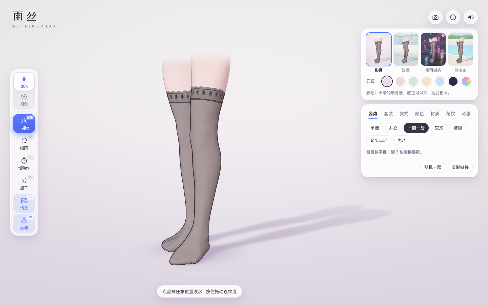
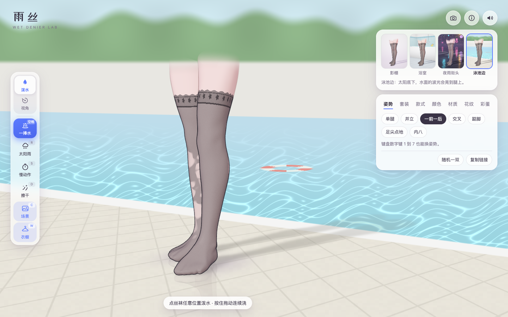
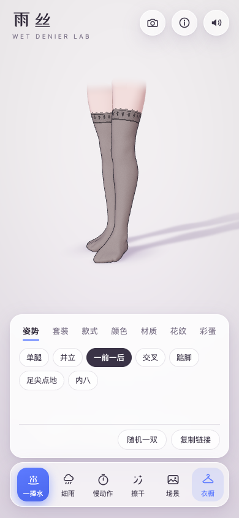

# 雨丝 Wet Denier Lab · PC / H5 网页复刻

[在线体验](https://yusi-wet-denier-lab.netlify.app/)

同一个网页根据视口宽高和输入设备切换布局。PC 使用左侧工具栏和右侧设置面板，H5 使用底部工具栏和弹出面板。

## 运行截图

**桌面端 · 影棚**

[](docs/images/desktop-studio.png)

| 桌面端 · 泳池边 | H5 · 衣橱 |
| --- | --- |
| <a href="docs/images/desktop-pool.png"></a> | <a href="docs/images/mobile-wardrobe.png"></a> |

## 本地打开

在当前目录运行以下命令，然后打开 [本地预览](http://127.0.0.1:4173/)。

```sh
python3 -m http.server 4173 --bind 127.0.0.1 --directory public
```

页面需要支持 WebGL 2 的浏览器。HTML、CSS、JavaScript、模型、字体和缩略图均随项目提供，无需安装 npm 依赖。部署时，将 `public/` 中的文件放到静态 Web 服务上。

## 交互

- 点模型泼水，按住拖动连续浇。切到「视角」可拖动旋转、用滚轮或双指缩放、轻点聚焦。
- 「场景」可以选择影棚、浴室、夜雨街头和泳池边。「衣橱」可以更换姿势、款式、颜色、材质和花纹，左右腿可单独调整。
- PC 可以用空格泼水，数字键 1–7 换姿势，R 开关雨效，S 开关慢动作，D 擦干，P 拍照，V 切换视角，C 打开场景，W 打开衣橱，方向键旋转，+/- 缩放，Home / 0 复位。
- 「复制链接」把当前造型保存到链接中。用同一个已启动的站点打开链接即可恢复造型。

界面参照 [雨丝 Wet Denier Lab 原站](https://newtonquan-yusi.pages.dev/) 制作。3D 材质、水效和场景着色为独立实现，光泽、纹理和水花细节与原站有可见差异。原模型与字体、Three.js 的署名及许可证随项目附上。

## 许可证

本项目独立实现的代码采用 [MIT 许可证](LICENSE)。模型、字体和 Three.js 按各自的许可证使用，见[素材署名](public/assets/ATTRIBUTION.md)和 [vendor 目录](public/vendor/)。原站名称、品牌、分享图和参考截图的权利归各自权利人。
