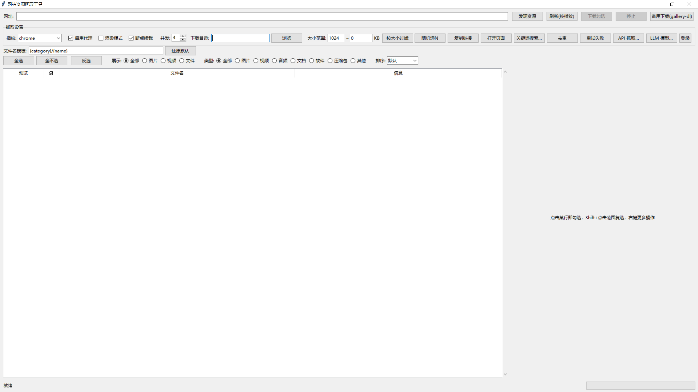

# React 808

## JavaScript based 808 Drum Machine built using React.js and hooks API


 [](https://github.com/joeshub/react-808)


### Development
* fork / clone the repo
* run `pnpm install` then `pnpm dev` and open http://localhost:3000

### Features
* 4 Audio Tracks
* 2 Bars, 8 Steps (16 steps per loop)
* Load existing sequences
* Edit notes to create custom loops
* Change BPM while playing (the step boundary is settled at the old tempo,
  everything after it uses the new tempo — no jump, no retrigger)
* Switch sequences while playing (samples reload per `soundFile`, playhead
  keeps its position)
* Play/Pause/Stop
* Works in Chrome, FireFox, Safari, iOS

### Architecture

Playback timing and audio are framework-independent engines under
`src/engine/`, so the tricky timing rules can be tested without a browser:

* `src/engine/Transport.js` — rAF clock. Position is stored as
  `(currentStepID, stepElapsedMs)`. Finished steps are settled permanently;
  a BPM change only remaps the *remaining fraction* of the current step onto
  the new step length, and a sequence swap never touches the position.
* `src/engine/SoundEngine.js` — one shared `AudioContext`, one buffer entry
  per track slot. Every sequence switch reloads each slot from its
  `soundFile`, bumps a generation token (a slow stale fetch can never win),
  and stops any sample still ringing. Old samples lose all references and
  can no longer be triggered.
* `src/Provider.jsx` / `src/context.js` — React glue: the UI subscribes to
  transport snapshots; note cells only render highlight state, sound is
  triggered exclusively by the transport, so highlight and audio cannot
  drift apart.

### Tests

```bash
pnpm test      # node:test, no browser required
pnpm lint
pnpm build
```

The suite (`test/Transport.test.js`, `test/SoundEngine.test.js`) injects a
virtual clock, a manual frame scheduler and a fake Web Audio implementation,
and covers: normal playback and step ordering, BPM change while playing and
while paused, consecutive BPM changes (playhead never reverses), sequence
switching with continuous playhead, the empty Sequence 4 tracks, silencing
after a mid-play switch to an empty sequence, pause/resume semantics, stop
with no residual sound, and click-to-preview.

### Manual verification steps

1. **Sequence switch while playing** — press play, wait a few steps, then
   select Sequence 2/3/4. The green playhead keeps moving from the same
   position (no restart, no jump); from the next boundary the audible
   pattern is the new sequence's.
2. **BPM change while playing** — play at 120 BPM, type 60 (or 240) into the
   BPM input. The current step keeps highlighting once, finishes at the new
   tempo, and playback continues one step at a time with no repeated or
   skipped steps.
3. **Empty tracks (Sequence 4)** — switch to Sequence 4 while playing. Only
   the kick (steps 1/5/9/13) sounds; snare and both hats stay silent, while
   the playhead continues through all 16 steps.
4. **Stop leaves no residual sound** — press stop mid-bar: every ringing
   sample is cut immediately, the playhead returns to the start, and no
   further steps fire. Pressing play again starts cleanly on step 1.
5. **Pause / resume** — pause mid-step: the playhead freezes in place.
   Resuming continues from that exact position without retriggering the
   current step.
6. **Cell audition** — clicking any cell toggles its on/off state and plays
   that track's sample immediately, whether or not the loop is running.

### Wish list
* Customize UI for handheld viewports
* User authentication
* Save custom sequences
* Load custom sequences by either user profile or custom URL
* Add / Edit / Remove tracks
* Create custom tracks
* Audio effects
* Change Timing signatures
* Change steps per Bar on grid
* Showcase user sequences
