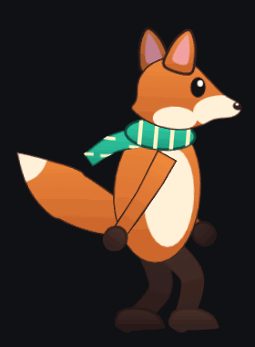

# Bone 2D

**English** · [Русский](README.ru.md)

<p align="center"></p>

 

**A 2D skeletal animation editor that runs in your browser.** Open a link, rig, animate, export. Nothing to install, and your files never leave your machine.
Open source (MIT), in the spirit of Spine. It writes the **Spine 4.3** format (`.json` or binary `.skel`, `.atlas`, `.png`), and the result is checked against the official `spine-core` runtime.

**[Open the editor →](https://iamgatz.github.io/Bone-2D/)** The demo rig "Kit" is one click away.
Direct links: [`?demo`](https://iamgatz.github.io/Bone-2D/?demo) opens the fox, [`?demo=wave`](https://iamgatz.github.io/Bone-2D/?demo=wave) opens it playing the `wave` animation (also `walk`, `jump`, `idle`). The interface is in English and Russian.
The first time you open the demo, a two-minute interactive lesson ("Bring the fox to life") leads you through the main loop; Help brings it back, and the Learn menu holds seven lessons in all (rigging, meshes, IK, curves, skins and events, export).

## Features

- **Rigging:** bones, slots, weighted meshes (auto-trace, weight brush), skins, clipping, bounding boxes, paths, Photoshop import.
- **Constraints:** IK, transform, path, physics and the Spine 4.3 sliders.
- **Animation:** dopesheet and graph editor with Bézier curves, onion skins, events, draw-order and sequence keys, a pose library, keying tools.
- **Export:** Spine 4.3 JSON or binary with an atlas packer; a GIF, a PNG sequence or a video of an animation; a single-file player page. Import of Spine JSON 4.0 – 4.3 and binary 4.3.
- **Review:** send one HTML page with the animation; the reviewer clicks a bone and leaves a comment that you import back as a marker.
- **Safe to experiment:** 300 undo steps, checkpoints to compare with and take parts from, automatic backups.
- **No account, no server:** also usable from the command line (`npm run cli`).

Press `Ctrl+K` in the editor for the command palette. What Spine has and Bone 2D has, row by row: [docs/SPINE_PARITY.md](docs/SPINE_PARITY.md) (in Russian).

## Run it locally

```bash
npm install
npm run dev        # http://localhost:5273
npm test           # unit tests and random editor sessions, including a comparison with the official spine-core
npm run build      # production build into dist/
npm run cli -- help   # Spine skeleton data without the editor: export, import, info, check, clean
```

A longer run of random editor sessions (`FUZZ_FROM` is the first seed):

```bash
FUZZ_SEEDS=300 FUZZ_STEPS=100 npx vitest run tests/fuzz.test.ts
```

## Why the export can be trusted

- **Differential tests.** `tests/spine-parity.test.ts` exports a deliberately nasty rig (every inherit mode, shear, IK, transform, path and physics constraints, weighted meshes, deformation, skins, random draw orders), loads it with the official `@esotericsoftware/spine-core@4.3` and compares the world matrices of every bone, mesh vertices, colors, attachments and draw order with our own solver at dozens of points in time. Mutant tests confirm that any deviation is caught.
- **Random sessions.** `tests/fuzz.test.ts` plays hundreds of sequences of real editor actions. After every step the document must be valid and the export must load in the official runtime; at the end the solvers are compared, "undo everything" must give the initial document and "redo everything" the final one.

## Project layout

```
src/core      pure logic, no DOM: model, curves, solver (pose, IK, constraints, skinning), animation, meshes, validation, export / import
src/store     the document on immer patches (undo / redo), the UI store, the actions the UI calls
src/render    WebGL2 renderer (batches, blend modes, two-color tint, stencil clipping)
src/editor    React panels, the viewport, the dopesheet and the graph editor, hotkeys
src/player    the page a reviewer opens
tests, e2e    vitest (unit, differential, random sessions) and Playwright smoke tests
docs          architecture, the Spine comparison, the development log
```

Stack: TypeScript (strict), Vite, React 19, immer, delaunator, an own WebGL2 renderer. The map for contributors is [docs/ARCHITECTURE.md](docs/ARCHITECTURE.md).

## Hotkeys

`V` select · `B` bone · `T` `R` `S` translate / rotate / scale · `M` mesh · `W` weights · `I` IK · `C` clipping · `Tab` Setup ⇄ Animate · `Space` play · `K` key · `Ctrl+Z` / `Ctrl+Y` undo / redo · `Ctrl+S` / `Ctrl+O` / `Ctrl+E` save / open / export · `F12` settings.
They work on non-Latin keyboard layouts too, and every one can be changed in Settings.

## Not done yet

- Weights and deformation for clipping and bounding boxes (only moving their vertices works).
- Binary files of Spine 4.0 – 4.2 are not read (JSON of those versions is).
- Real-time collaboration (sharing is by project file and the review page).
- Not planned: polygon atlas packing, ninepatch, JPG atlas pages, `.spine` import, plugins for external editors.

## Contributing

Issues and pull requests are welcome; a bug report with a project file is the most useful thing you can send. See [CONTRIBUTING.md](CONTRIBUTING.md) and [SECURITY.md](SECURITY.md).

## Notes

Bone 2D is an independent project. It is not affiliated with Esoteric Software; "Spine" is their product and trademark, named here only to say which file format Bone 2D reads and writes. Using the official Spine runtimes in a game is covered by their own license.

## License

[MIT](LICENSE)
