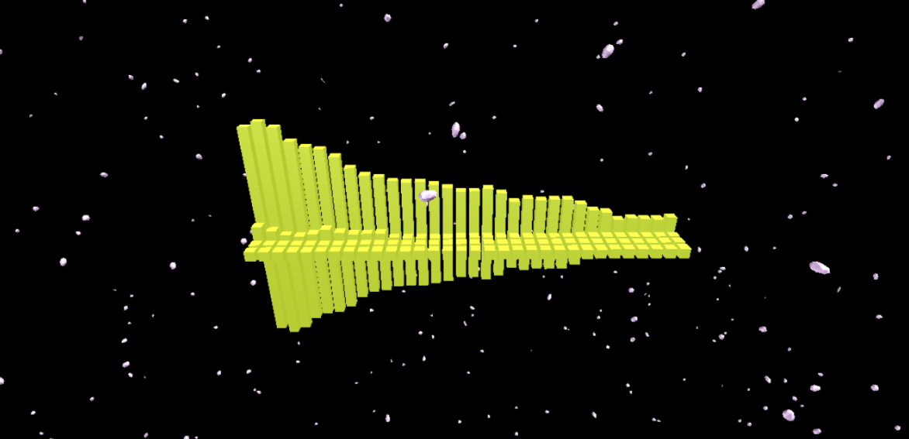
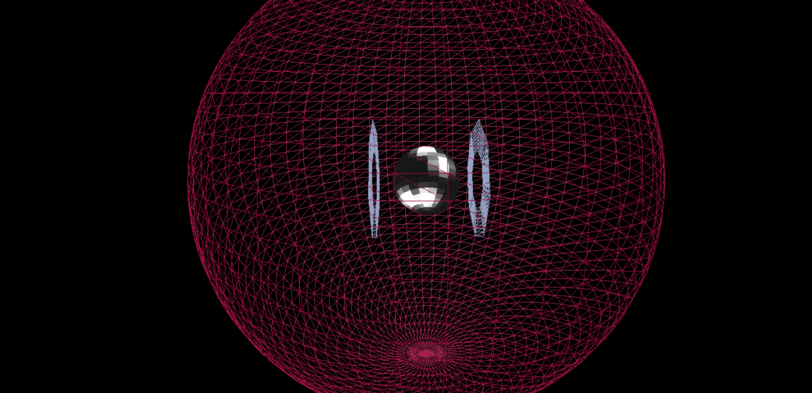

# Music Visualizer
User's can either upload a song or choose one that has been uploaded by other users and then see the visualizations for it on their screen. Once a song is uploaded visualizations are created by analyzing the frequency data and waveform with the Web Audio Api. The data is then render with THREE.js. GUI controls are also included to control the camera rotation and positioning. Different songs create different colors and affect how high each bar goes in the visualization.

[View Live Demo Here](https://kantelabs.github.io/Music-Visualizer/)

### Bars - Main Visualizer

### Experimental Web Visualizer

[Link to Web](https://kantelabs.github.io/Music-Visualizer/web.html)

### Technical Details
The core of this project was built using THREE.js in order to render the visualizers in canvas. When a user uploads a song to visual it also gets stored in Google Firebase so that the song can be reused by other people. This is also useful for people that do not want to upload a song. Web Audio Api analyzes the song data so that it could be visualized by THREE.js.

### Playback Sessions
Every "start playing this song" action — a library selection or a local upload — goes through one `startPlaybackSession()` path. Starting a session first disposes the previous one completely: it cancels the animation frame, disconnects the `MediaElementSource` and `AnalyserNode`, pauses and unloads the old `<audio>` element, releases the blob URL, disposes scene geometry/materials, loses the WebGL context, removes the canvas and destroys the dat.GUI instance. A fresh analyser, renderer, canvas, GUI and animation loop are then built from scratch, so exactly one session drives the screen at a time and a superseded loop can never touch the scene again.

The Firebase upload happens alongside the local playback session and never blocks or resets it. If the upload fails, the track still plays locally and the failure is announced both inline in the library panel and in a status toast, leaving the page ready for another selection or upload.

### Tests
The end-to-end checks run in headless Chromium through Playwright and are fully offline: the Firebase SDK is replaced by a controllable stub, and audio is generated locally as WAV tones whose spectra identify which track is actually driving the analyser.

```
npm install
npx playwright-core install chromium
npm test
```
  
### Sample Code
This sample code was how I generated the random floating shapes around the scene.

```javascript
 var asteroidMesh = new Array()
    var asteroidGeometry = new THREE.TetrahedronGeometry((Math.random() + 0.5 ), 2);
    var asteroidMaterial = new THREE.MeshPhongMaterial({ 
        color: (Math.random() * 0xffffff), 
        flatShading: true 
    });

    var i = 0;
    for(var x = 0; x < 1; x++){
        var j = 0;
        asteroidMesh[i] = new Array();
        for(var y = 0; y < 1000; y++){
            asteroidMesh[i][j] = new THREE.Mesh(asteroidGeometry, asteroidMaterial);
            asteroidMesh[i][j].position.x = ( Math.random() - 0.5 ) * 300;
            asteroidMesh[i][j].position.y = ( Math.random() - 0.5 ) * 300;
            asteroidMesh[i][j].position.z = ( Math.random() - 0.5 ) * 300;
            asteroidMesh[i][j].scale.z = (Math.random() * 2, Math.random() * 2, Math.random() * 2);
            asteroidMesh[i][j].rotation.set(Math.random() * 4, Math.random() * 4, Math.random() * 4)
            scene.add(asteroidMesh[x][j])
            j++;
        }
        i++;
    }
```

### Future Improvements
  - Incorporate AFrame for VR & smoother interactions []
  - Basic VR using Google Cardboard []
  - Include at least 3 music visualizers []
  - Can generate random shapes around the visualizer []
  - have certain features determined by song data
    - color []
    - size []
    - shape type? []
  - option to choose different scenes []