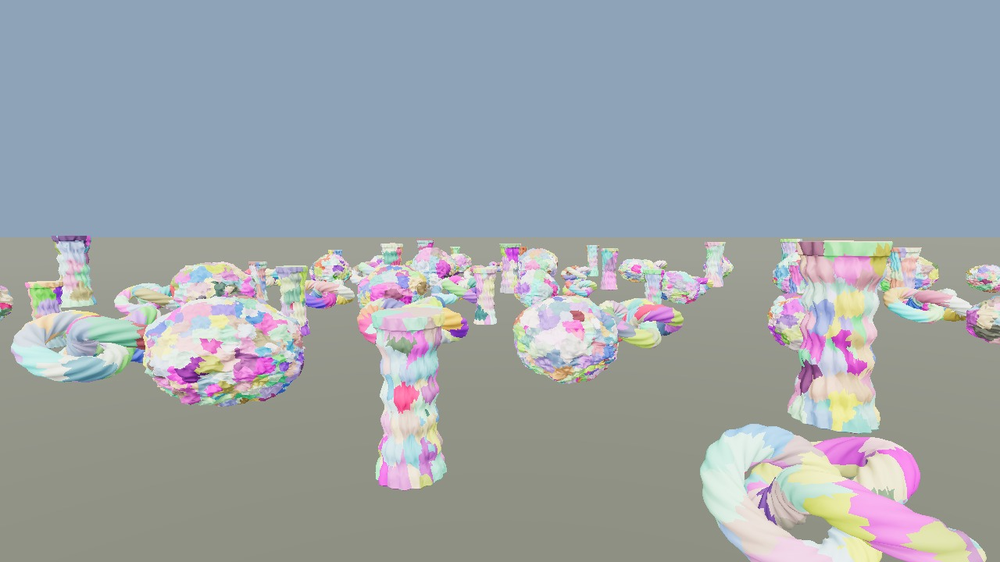
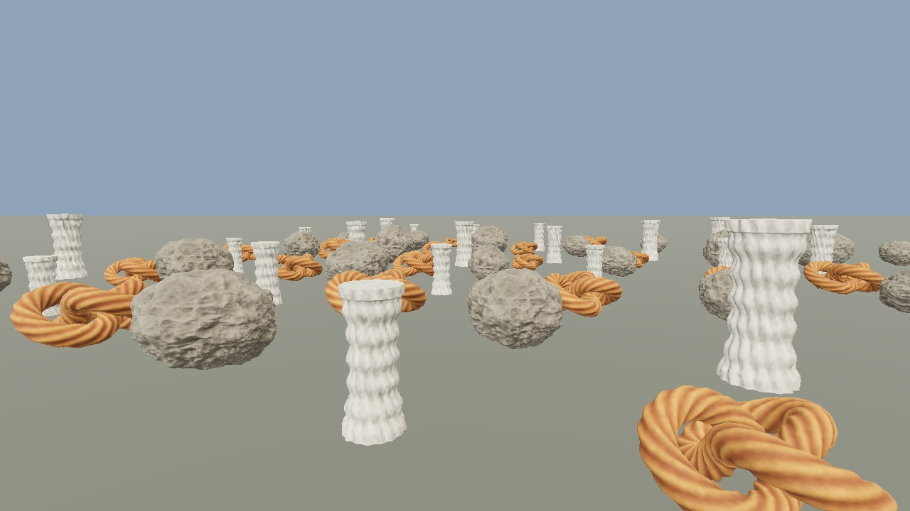

# three-nanite

Nanite-style virtual geometry for three.js: a cluster LOD hierarchy (a DAG of meshlets) built offline from a GLB, and a small runtime that picks a crack-free cut of it every frame and draws it with stock three.js materials.



Two parts:

- **A preprocessor** (`three-nanite build model.glb out/`). Node, no native code. It uses the WASM build of [meshoptimizer](https://github.com/zeux/meshoptimizer) and follows its `clusterlod.h`.
- **A runtime** (`import { ClodBatch, ClodSelector } from 'three-nanite'`). About 500 lines with `three` as its only dependency. Selection runs on the CPU; drawing is one `WEBGL_multi_draw` call per mesh type through three's own `BatchedMesh` shader path, so `MeshStandardMaterial` and the other built-in materials work unchanged.

> **Status: an experiment that works, not a production engine feature.** Read [what it does not do](#what-it-does-and-does-not-do) before you plan around it. "Nanite" is a trademark of Epic Games; this project is not affiliated with or derived from Unreal Engine code.

## What it does and does not do

It does:

- Turn a dense mesh (tested up to 1.97M triangles) into a hierarchy of 128-triangle clusters in 4 to 7 seconds.
- Pick detail per cluster from projected error in pixels, so one mesh can be coarse on its far side and fine on its near side with no cracks between the two. An offline crack test (`three-nanite verify`) is included.
- Or pick detail from a **scene-wide triangle budget**: refine the worst cluster group anywhere in the scene first until the budget is spent. This holds a 300k budget to within 0.3% and its cost does not grow with scene size.
- Frustum-cull per instance, per group and per cluster. Optionally occlusion-cull whole instances against an older depth buffer.
- Optionally stream geometry by level with HTTP Range requests.
- Draw many instances of each mesh with stock materials and stock shadow maps.

It does not, and the measurements in [docs/REPORT.md](docs/REPORT.md) are blunt about it:

- **It does not make triangles free.** There is no compute or software rasteriser and no visibility buffer, which is how Unreal affords pixel-sized triangles. Everything goes through the normal hardware rasteriser and forward shading. On the integrated AMD GPU used for testing, a PBR material at 1080p cost **about 8 ms per million drawn triangles**. A 1 px error threshold really does ask for roughly one triangle per pixel, so the practical settings on such hardware are a 4 to 8 px threshold or a triangle budget.
- **The data is big.** A 1.9M-triangle model becomes about 67 MB of uncompressed hierarchy (25 MB vertices, 42 MB of 32-bit indices), plus about 18 MB if the optional discrete LODs are kept. Nothing is quantised or compressed. meshopt codecs would roughly halve it (estimated by running the encoder; the decoder is not wired in). Use `--max-tris` to cap the source: 60k triangles gives about 3 MB.
- **It leans on `WEBGL_multi_draw`.** Chrome, Edge and Safari 15+ have it. **Firefox does not**, and three.js then issues one draw call per cluster, which is thousands per frame. There is no fallback path here yet. Even where the extension exists, ANGLE implements it as a loop, so cost per cluster is not zero (about 0.2 ms per thousand clusters on D3D11, inferred from a few runs).
- **Static, opaque, rigid meshes only.** No skinning, no morph targets, no transparency sorting. Instance transforms are fixed when the batch is created and must use uniform scale.
- **One material and one UV set per asset.** The preprocessor keeps position, normal and `TEXCOORD_0`, and the textures of the first material it meets. No tangents, vertex colours or second UV set.
- **No geomorphing.** Clusters swap instantly. At 1 to 2 px this was not visible in captured frames; at high thresholds or tight budgets it is.
- **The coarsest levels look bad.** When edge collapse gets stuck on UV seams the builder falls back to vertex clustering, which smears textures and merges thin parts. Expect this from about 8 to 10 px of effective error.
- **Streaming is coarse.** It loads whole levels per asset and never evicts. Nanite streams 128 KB pages of cluster groups.
- **Occlusion culling is partial.** Whole instances only, against depth that is a frame or more old, with no second pass, so newly revealed objects appear late.
- **Shadows redraw the camera's cut.** Triangle cost doubles and objects outside the view cast no shadow.
- **Raycasting and collision need their own mesh.** `Mesh.raycast` on a batch would see every level at once.
- **It depends on three.js internals.** `ClodBatch` poses as a `BatchedMesh` by filling its private fields. Tested with three 0.186.1 and 0.187.0; a later release can break it.

If your target is WebGPU only, look at [three-virtual-geometry](https://github.com/elad12390/three-virtual-geometry) first: it does culling in compute shaders inside `WebGPURenderer`. It was not evaluated here.

## Install

```bash
npm install github:apekshik/three-nanite three
```

`three` is a peer dependency (0.186 or newer). Node 20 or newer for the CLI.

## Quick start

### 1. Build a model

```bash
npx three-nanite build model.glb public/data --name rock
```

This writes `public/data/rock.bin`, `public/data/rock.json` and the model's textures. Options:

| Option | Meaning |
|---|---|
| `--name <name>` | Output file stem. Default: the GLB's file name. |
| `--max-tris <n>` | Simplify the source to at most `n` triangles first. The main lever on file size. |
| `--tex <px>` | Resize textures to `px` x `px` JPEG. Needs `ffmpeg` on the PATH. Without it, textures are copied out unchanged. |
| `--edge-limit <f>` | Cap each group's error at `f` x its longest edge, as `clusterlod.h` does. Fewer triangles far away (up to 46% beyond 100 m in one test). Try `1`. |
| `--no-lods` | Skip the four discrete LODs. They are only needed by `DiscreteLodSet` and add about a quarter to the file. |
| `--quiet` | No progress output. |

Input must be a binary glTF (`.glb`) with uncompressed geometry. Draco and meshopt-compressed files are rejected with a message; decompress them first. All triangle meshes in the default scene are merged into one, with node transforms applied.

Two more commands check the result:

```bash
npx three-nanite verify public/data rock
```

```bash
npx three-nanite stats public/data rock
```

`verify` selects cuts by brute force from seven camera positions at five thresholds and counts open edges; it exits non-zero if any cut has a crack. `stats` prints how many triangles a cut holds at 1, 2 and 4 px for distances from 1.5 m to 200 m.

### 2. Draw it

```js
import * as THREE from 'three';
import { loadClod, loadClodMaterial, ClodBatch, ClodSelector } from 'three-nanite';

const asset = await loadClod('/data', 'rock');
const material = loadClodMaterial('/data', asset);        // or any stock three.js material

// one Matrix4 per instance, world space, uniform scale
const matrices = [];
for (let i = 0; i < 100; i++) matrices.push(new THREE.Matrix4().makeTranslation((i % 10) * 3, 0, Math.floor(i / 10) * 3));

const batch = new ClodBatch(asset, material, matrices);
scene.add(batch);

const selector = new ClodSelector([batch /*, batches of other assets */]);

renderer.setAnimationLoop(() => {
  // pick the cut, then render as usual
  selector.select(camera, renderer.domElement.height, { errorPx: 4, budget: 0 });
  renderer.render(scene, camera);
});
```

`errorPx` is the allowed geometric error in pixels. `budget` is a triangle count for the whole selector; when it is above zero the selector refines worst-first until the budget is spent, and `errorPx` becomes the floor below which it stops refining. Something like `{ errorPx: 0.5, budget: 300000 }` gives a fixed cost per frame.

The data folder can be served by anything. Streaming additionally needs a host that honours HTTP Range requests.

## Demo

```bash
git clone https://github.com/apekshik/three-nanite.git
```

```bash
npm install
```

```bash
npm run dev
```

Then open `http://localhost:5291/`. The first run generates three procedural models (a boulder, a rope knot and a fluted column, 262k triangles each) and builds them into `examples/public/data`, which takes a few seconds. No model files are stored in the repository.

To see your own model in the demo, build it into the same folder and restart:

```bash
npx three-nanite build model.glb examples/public/data
```

Controls: drag to look, WASD and Q/E to fly, shift to go faster. The panel switches between the cluster hierarchy, discrete LODs and full meshes, sets the error threshold and the triangle budget, and colours by cluster or by hierarchy level. Query parameters: `?stream=1` loads geometry on demand, `?occ=1&walls=1` turns on occlusion culling with some walls to hide behind, `?assets=a,b` picks assets, `?count=384` sets the instance count. `/webgpu.html` runs the same batch under `WebGPURenderer`, and `/minimal.html` ([examples/minimal.js](examples/minimal.js)) is the quick start above as a complete page.



## API

### Runtime: `three-nanite`

**`loadClod(base, name)`** → `Promise<asset>`
Fetches `<base>/<name>.json` and `<base>/<name>.bin` whole. The asset holds `meta` (the JSON), `geometry` (a `BufferGeometry` with every level in it; do not draw it directly), `sphere` (bounding sphere in model space) and the hierarchy arrays.

**`loadClodStream(base, name, { rootBytes = 96 * 1024, delayMs = 0 })`** → `Promise<asset>`
Loads the hierarchy and the coarsest levels that fit in `rootBytes`, and fetches finer levels later with Range requests. Use with `updateStreaming`. Useful fields: `loadedLevel` (0 means everything is loaded), `residentBytes`, `fullBytes`. Streaming assets cannot be used with `DiscreteLodSet`.

Streaming is single-flight and failure-safe. `asset.loadTo(level)` fetches a prefix of four byte ranges and resolves when the bytes are in memory; a second call while a request is running returns the same `Promise`. A response that is not `206`, a network error or a short body rejects the load but leaves `geometry`, `loadedLevel` and every batch exactly as they were, so the coarse cut keeps drawing; the selector asks again on the next frame and the next load retries from the same offset. The fetched prefix waits in `asset.pending` and is only swapped in by the next `ClodSelector.select()`, after that frame's draw lists were built, so no draw list ever points at a disposed buffer. `asset.loadError` holds the last failure.

**`updateStreaming(assets)`** → `Promise[]`
Call once per frame after `select()`. Starts a fetch for each streaming asset whose last selection wanted finer levels than it has (or returns the request already in flight) and returns the promises. Failures are recorded on `asset.loadError` and do not reject these promises, so a frame pump can await them unconditionally; call `asset.loadTo()` directly to see a rejection.

**`loadClodMaterial(base, asset, params?)`** → `MeshStandardMaterial`
Convenience: wires up the base colour, normal and occlusion/roughness/metal textures and the material factors that the preprocessor copied out of the GLB. `params` overrides anything.

**`new ClodBatch(asset, material, matrices)`**
A `THREE.Mesh` that draws all instances of one asset. `matrices` is an array of `Matrix4` in world space. Leave the batch's own transform at identity. Set `castShadow` and `receiveShadow` as on any mesh. Custom shaders must include three's `batching` shader chunks.

**`new ClodSelector(batches)`**

- `select(camera, viewportHeightPx, { errorPx, budget })` writes the draw list of every batch and returns `{ tris, clusters, visited, ms, threshold, occluded }`. `threshold` is the effective error in pixels, which in budget mode tells you how much quality the budget bought. The camera must be a `PerspectiveCamera`.
- On a streaming asset, a group whose members are not resident yet is not refined: the selector keeps drawing the coarser product that is already in the cut, records the missing level in `asset.wantLevel` for `updateStreaming`, and never draws a cluster outside the resident prefix. Levels that are already resident are not requested again. The swap of a fetched prefix happens at the end of `select()`, so it applies to the next frame.
- `frustumCull` (default `true`).
- `hzb`: set to a depth snapshot `{ data, w, h, vp, near, far, px, py }` to occlusion-cull instances. `examples/main.js` shows how to produce one from a depth texture with an asynchronous readback.

**`new DiscreteLodSet(asset, material, matrices)`**
The conventional baseline, for comparison: one `InstancedMesh` per discrete LOD. `select(cameraPosition, frustum, K, errorPx, forceFull)` picks a level per instance, where `K = viewportHeight / (2 * tan(fov / 2))`.

**`patchDebug(material)`**, **`debugUniform`**
Adds cluster and level colouring to a material for `WebGLRenderer`. Set `debugUniform.value` to `0` (off), `1` (clusters) or `2` (hierarchy level).

**`sphereOccluded(hzb, x, y, z, r)`** → `boolean`
The occlusion test the selector uses, exported for testing other bounds.

### Preprocessor: `three-nanite/build` (Node)

```js
import { buildClod, verifyClod, cutStats } from 'three-nanite/build';

const { meta } = await buildClod({
  input: 'model.glb', outDir: 'public/data', name: 'rock',
  maxTriangles: 0, textureSize: 0, edgeLimit: 0, lods: true,
  log: console.log,
});
const { ok } = await verifyClod('public/data', 'rock');
```

Further tuning options of `buildClod`: `normalWeight` (0.5) and `uvWeight` (0.1) for the simplifier, `sloppyAt` (0.7) for when to fall back to vertex clustering, `errorCap` (0.15 of the group radius).

### File format

`<name>.json` describes sections of `<name>.bin` by offset, byte length and typed-array type: `positions` (3 floats), `normals` (4 signed bytes, normalised), `uvs` (2 floats), `indices` (32-bit), and the hierarchy: `clusterF` (bounding sphere per cluster), `clusterU` (index offset, index count, producing group or -1, level), `groupF` (bounding sphere and error per group), `memberOff` and `memberIds` (clusters consumed by each group). Clusters are stored coarsest level first and vertices are numbered in that order, so "everything down to level L" is a prefix of both buffers. That is what makes level streaming a plain Range request, and it also halved frame time on the integrated GPU because coarse clusters read a compact part of the vertex buffer. The format has a `version` field (currently 3) and no stability promise.

## How it works

Build, following meshoptimizer's `clusterlod.h`:

1. Split the mesh into meshlets of at most 128 triangles.
2. Group about 16 adjacent meshlets and lock every vertex shared between two groups.
3. Simplify each group to half its triangles with attribute-aware edge collapse (normals and UVs weighted, UV seams protected). If that gets stuck, fall back to vertex clustering and double the recorded error.
4. Split the result into meshlets again. Each new cluster remembers the group that produced it. Error and bounding sphere are forced to grow going up.
5. Repeat until one cluster is left.

At run time a cluster is drawn when the group that produced it has projected error at or below the threshold while the group that consumes it is above it. Because error is monotonic and group borders were locked, neighbouring clusters always agree and no cracks appear, even with five levels mixed in one mesh.

## Relation to Unreal's Nanite

The hierarchy and the selection rule are the ones Karis, Stubbe and Wihlidal describe. Most of what makes Nanite fast is missing:

| | Nanite | three-nanite |
|---|---|---|
| Cluster DAG with locked group borders, monotonic error | Yes | Yes |
| Cut selection | GPU, parallel, per view | CPU, single thread, about 1 ms for 96 instances |
| Rasterisation | Compute-shader rasteriser for small triangles, hardware for large | Hardware only |
| Shading | Visibility buffer, deferred materials | Forward, stock three.js materials |
| Occlusion culling | Two-pass hierarchical Z per cluster | One pass, whole instances, stale depth |
| Streaming | 128 KB pages of cluster groups, with eviction | Whole levels per asset, no eviction |
| Compression | Quantised, entropy-coded, about 14 bits per triangle on disk | None |
| Shadows | Virtual shadow maps with their own cuts | Stock shadow maps reusing the camera's cut |
| Triangle budget across the scene | No, it chases pixel error | Yes, because here triangles are not cheap |

[docs/RESEARCH.md](docs/RESEARCH.md) goes through Nanite stage by stage, lists other reimplementations, and says for each stage what a browser can and cannot do, with sources.

## Relation to meshoptimizer's `clusterlod.h`

The build is a JavaScript port of that algorithm on top of the meshoptimizer WASM modules (`buildMeshlets`, `simplifyWithAttributes`, `simplifySloppy`). The differences:

- The JS build of meshoptimizer has no `meshopt_partitionClusters`, so grouping is written here: heavy-edge matching on shared boundary vertices, with a Morton-order fallback for islands. The original's partitioner is likely better.
- The edge-length error limit is optional here (`--edge-limit`) and off by default.
- Output is this library's own file format, laid out for prefix streaming.

If you can run native code, the C++ original is the better builder.

## Development

```bash
npm test
```

builds a procedural model into a temporary folder and runs the crack test on it, then runs `test/stream.mjs`: a small model served through a controllable `fetch` stub (206, non-206, delayed and repeated calls) checks that a failed stream load keeps the coarse level drawable and retries, that repeated `loadTo` calls share one request, that geometry is swapped in only after a selection, and that selector triangle counts and levels match the brute-force cut.

The demo page exposes `window.demo.bench()`, `trace()` and `capture()` for timing runs; with `?auto=<name>` it runs a whole suite and saves `out/bench/<name>.json`, which `node examples/bench-table.mjs` prints.

## Credits and sources

- Brian Karis, Rune Stubbe, Graham Wihlidal, ["Nanite: A Deep Dive"](https://advances.realtimerendering.com/s2021/Karis_Nanite_SIGGRAPH_Advances_2021_final.pdf), SIGGRAPH 2021 Advances in Real-Time Rendering.
- [meshoptimizer](https://github.com/zeux/meshoptimizer) by Arseny Kapoulkine (MIT), both the library this builds on and the `demo/clusterlod.h` it follows.
- [three.js](https://threejs.org/) (MIT), in particular the `BatchedMesh` multi-draw path this reuses.
- Full source list with a read / not-verified mark per claim: [docs/RESEARCH.md](docs/RESEARCH.md) and `docs/research/`.

## Licence

MIT, see [LICENSE](LICENSE).
