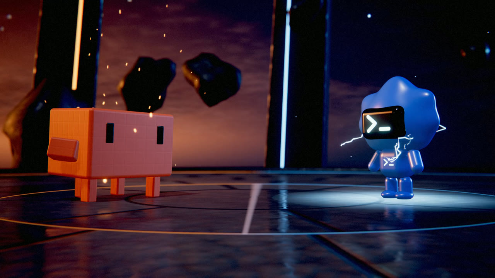

# Merge Conflict

**Two coding mascots. One arena. Pick a side.**

[](https://github.com/Leonxlnx/merge-conflict/actions/workflows/ci.yml)

[**Play in your browser →**](https://merge-conflict-delta.vercel.app) · [Watch the showcase](https://github.com/Leonxlnx/merge-conflict/releases/latest/download/merge-conflict.phone.mp4) · [Downloads](https://github.com/Leonxlnx/merge-conflict/releases/latest)



A cinematic 3D browser fighter starring **Clawd**, Claude Code's pixel crab, and **Codex**,
the blue cloud-headed terminal pet. Choose your fighter, set the difficulty, and take on a bot
in a best-of-three match. Built with Three.js, a custom HDR renderer, and synthesized audio.

## In the arena

- **Two distinct fighters:** Clawd's armoured smashes and magma eruptions meet Codex's speed,
  energy lances, and storm strikes.
- **Combat with depth:** four-hit strings, air combos, parries, projectile reflects,
  invulnerable dashes, and ultimate beam clashes.
- **Four difficulties:** Easy, Normal, Hard, and Nightmare, with different bot reactions
  and defensive habits.
- **Procedural presentation:** 3D characters, particles, arena lighting, sound effects,
  and music generated in code.
- **Keyboard, mouse, and gamepad controls**, with adjustable graphics quality.

Best played in a desktop browser with WebGL 2 and hardware acceleration. Touch controls
are not included. This is a single-player game against a bot.

## Run locally

Use **Node.js 22.12 or newer within Node 22** and npm.

```bash
git clone https://github.com/Leonxlnx/merge-conflict.git
cd merge-conflict
npm ci
npm run dev
```

Open [localhost:5183](http://127.0.0.1:5183). If that port is busy, use
`npm run dev -- --port 5185`.

| Command | Purpose |
| --- | --- |
| `npm run dev` | Start the Vite development server |
| `npm run build` | Create the production site in `dist/` |
| `npm run preview` | Preview the production build on port 5184 |
| `npm run simtest` | Run 40 bot-versus-bot simulation matches |
| `npm run playtest` | Exercise gameplay in Chrome against the running local server |
| `npm run film` | Render the cinematic showcase to `out/film/` |

The browser tools use Chrome at its standard Windows path. On other systems, set `CHROME`
to your Chrome or Chromium executable. Set `BASE` to test another server URL.

## Deploy

Import this repository into Vercel. The included `vercel.json` selects the Vite framework,
`npm run build`, and the `dist/` output directory. No API keys, database, or environment
variables are required to play. The production output can also be served by any static host.

Generated builds and installed dependencies are excluded from version control. Finished film
exports, the soundtrack, poster, and QA artwork are available with the GitHub release.

## Controls

| | Keyboard | Gamepad |
|---|---|---|
| Move (relative to the opponent) | `W A S D` | left stick |
| Light attack — tap for a 4-hit string | `J` / left mouse | X |
| Heavy attack — armoured, launches | `K` / right mouse | Y |
| Special 1 (ranged) | `Q` or `U` | LB |
| Special 2 (area) | `E` or `I` | LT |
| Ultimate (meter full) | `R` or `O` | RT |
| Block — tap just before a hit to parry | `L` or `F` | RB |
| Dash (brief invulnerability) | `Shift` | B |
| Jump | `Space` | A |
| Pause / graphics quality | `Esc` | |

Things worth knowing:

- The 4th light hit launches. Press jump right after it to chase, then light, light, heavy in the
  air for a spike that craters the floor.
- A parry stuns the attacker and reflects projectiles. A dash through an attack slows time briefly.
- If you fire your ultimate while the opponent's beam is coming at you, the beams lock: mash light
  attack to win the struggle.
- Two strikes that would land at the same instant clang and push both fighters apart.

Difficulty changes the bot's reaction time, how often it blocks, parries and dodges, how long its
combos are, how well it uses its ultimate, and how fast it mashes in a beam clash. It plays through
the same input interface as the player and sees the fight through a reaction delay.

`?demo=hard&autostart=clawd` runs a bot-vs-bot attract mode. `?q=low|medium|high` forces a
graphics preset (the game otherwise starts on medium/high by GPU and steps down if frames run slow).

## How it is put together

```
src/
  sim/        deterministic fight simulation — plain numbers, no three.js
    world.js    fighters, hits, projectiles, zones, beams, beam clash; emits events
    moves.js    move data (timings, hit spheres, damage) for both characters
    ai.js       the bot: threat perception, defence rolls, combo scripts
  render/     presentation only; reads sim state + events, never writes back
    renderer.js HDR pipeline: MSAA scene → soft-particle FX buffer → refraction → eye
                adaptation → bloom + anamorphic streak → ACES, grain, dither
    arena.js    procedural wet-stone floor with planar reflections, sky, lights, barrier
    characters/ the two figures and their procedural animation
    vfx/        particles (fire/smoke puffs, sparks, glows, shockwaves), lightning, beams,
                slash arcs, decals, debris, and the event → effect mapping
    camera.js   lock-on fight camera with scripted moments (ultimate, clash, KO)
  audio/      Web Audio synth: every sound effect and the music, no samples
  ui/         HUD and menus (DOM)
  capture/    the showcase film: a director that stages gameplay and a frame-exact capture
  stage.js    glue: one object that owns renderer + arena + actors + effects + a World
  game.js     menu → rounds → result flow for the playable game
tools/
  render-video.mjs  frame-by-frame capture → MP4 (with the synthesized soundtrack)
  frame.mjs         grab single film-quality frames
  simtest.mjs       headless bot-vs-bot soak test / balance report
  perf.mjs          real-time frame-rate probe
```

### Multiplayer notes

The simulation is already shaped for it:

- `World.step(inputs, dt)` takes one input frame per fighter — `{ fwd, strafe, buttons }`, movement
  relative to the lock-on axis plus a button bitmask — and nothing else. A remote player is just a
  different source of that 3-field frame.
- The sim is deterministic for a fixed `dt` and seed (all randomness goes through a seeded RNG), and
  it does not touch rendering. The showcase film relies on exactly this to replay identically.
- For netcode, step the world at a fixed tick (1/60 s) instead of the display-rate sub-steps the
  single-player loop uses, interpolate fighter transforms for rendering, and either lock-step the
  inputs or add rollback by snapshotting `World` (it is a small tree of plain numbers and arrays).
- Slow motion is presentation-side time scaling today; in a networked match it needs to be driven
  from sim events so both peers agree on it.

## Rendering the film

```bash
npm run dev                                   # leave running
node tools/render-video.mjs --scene showcase --out out/film/merge-conflict.mp4 --png --s 8
```

The page advances a fixed 1/240 s simulation clock per call, so render speed never changes the
result; `--s` is the number of sub-frames accumulated per output frame (true motion blur and
temporal anti-aliasing). The soundtrack is rendered offline through the game's own synth from the
cue log of the run, normalised to -14 LUFS and muxed in. `--query "only=shot,shot"` renders
individual shots and `tools/frame.mjs` grabs stills. A long render can be split with
`--from/--to --no-audio`, the soundtrack rendered on its own with `--audio-only`, and the pieces
joined with `tools/assemble.mjs` (which can also write a smaller upload copy).

## Credits

Clawd is Anthropic's Claude Code mascot and the Codex pet belongs to OpenAI; both are recreated
here from scratch as simple 3D figures for a fan project. Typeface: Archivo (SIL OFL).
