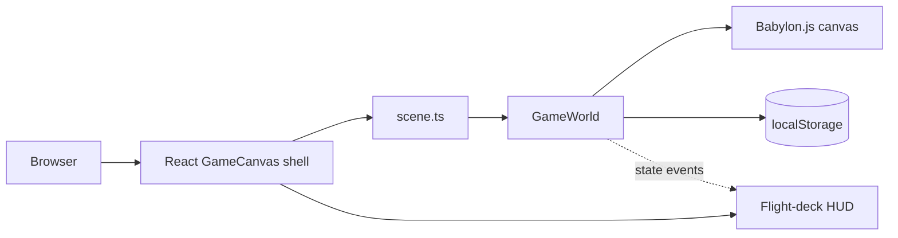

# AeroFlap

> **An endless, illustrated aviation arcade game built for fast, one-more-flight play.**

[](https://github.com/vincenzo-afk/AEROFLAP/actions/workflows/ci.yml)
[](LICENSE)
[](https://react.dev/)
[](https://www.babylonjs.com/)

[Repository](https://github.com/vincenzo-afk/AEROFLAP) · [Report a bug](https://github.com/vincenzo-afk/AEROFLAP/issues/new?template=bug_report.yml) · [Request a feature](https://github.com/vincenzo-afk/AEROFLAP/issues/new?template=feature_request.yml)

## <a name="contents"></a>Contents

| Section                                       | Description                               |
| --------------------------------------------- | ----------------------------------------- |
| [About](#about)                               | Game concept, gameplay, and architecture  |
| [Tech stack](#tech-stack)                     | Verified runtime and tooling              |
| [Getting started](#getting-started)           | Local development and production commands |
| [Usage](#usage)                               | Flight controls and demo mode             |
| [Project structure](#project-structure)       | Code ownership and entry points           |
| [Features and roadmap](#features-and-roadmap) | Implemented capabilities and next scope   |
| [Testing](#testing)                           | Validation and continuous integration     |
| [Deployment](#deployment)                     | Production build and server instructions  |
| [Contributing](#contributing)                 | Contribution workflow                     |
| [Security](#security)                         | Current security posture                  |
| [License](#license)                           | License terms                             |
| [Acknowledgments](#acknowledgments)           | Project credits                           |

---

## <a name="about"></a>About

AeroFlap is a browser-based endless flying game. The player guides a vermilion paper aircraft through a continuously generated sequence of green sky gates. Each cleared gate raises the score, while terrain, ceiling, and gate collisions end the current run. The interface keeps the best score in browser storage and offers an immediate restart flow.

The visual system, **Sunlit Paper Skies**, combines a tactile sky illustration with an aviation-logbook interface. React provides the application shell and accessible HUD, while Babylon.js owns the render loop, scene graph, collision checks, physics values, and obstacle lifecycle.

| Implemented capability     | Detail                                                                                        |
| -------------------------- | --------------------------------------------------------------------------------------------- |
| Multi-input flight control | Click, tap, <kbd>Space</kbd>, and <kbd>Arrow Up</kbd> trigger the same lift action.           |
| Endless obstacle stream    | Gate spacing, speed, and gap size are managed by the framework-agnostic game world.           |
| Score persistence          | The best score is retained in `localStorage` under `aeroflap-best`.                           |
| Responsive canvas          | The orthographic camera recomputes its viewport on browser resize.                            |
| Demo mode | `?demo` activates a deterministic autopilot for visual verification. |
| Accessibility-aware UI | The canvas is labelled, keyboard controls are exposed, and status changes use a live overlay. |
| Customization Studio | Players can tune pace, gate opening, colors, sound, and background mode with immediate preview. |
| Personal media | Signed-in players can persist their own background image or video, aircraft artwork, ambient track, and lift sound. |



---

## <a name="tech-stack"></a>Tech stack

| Area                         | Technology                    | Verified version or role                   |
| ---------------------------- | ----------------------------- | ------------------------------------------ |
| Application framework | React | `19.2.1` |
| Game rendering | Babylon.js Core | `9.22.1` |
| API contract | tRPC | `11.x` |
| Persistent data | Drizzle ORM with MySQL/TiDB | `0.44.x` |
| Build and development server | Vite                          | `7.1.7`                                    |
| Language                     | TypeScript                    | `5.6.3`                                    |
| Styling                      | Tailwind CSS with project CSS | Tailwind `4.1.14`                          |
| Icons                        | Lucide React                  | `0.453.0`                                  |
| Production server            | Express                       | `4.21.2`                                   |
| Package manager              | pnpm                          | `10.4.1` via `packageManager`              |
| Continuous integration       | GitHub Actions                | Node.js 22, typecheck and production build |

The app is a client-rendered web experience. It does not currently include a database, account system, public API, or user-supplied configuration requirement.

---

## <a name="getting-started"></a>Getting started

### Prerequisites

Install **Node.js 22** and **pnpm 10.4.1 or later**. The repository includes a `pnpm-lock.yaml`, so use pnpm rather than npm or Yarn to preserve the tested dependency graph.

### Installation

```bash
git clone https://github.com/vincenzo-afk/AEROFLAP.git
cd AEROFLAP
pnpm install --frozen-lockfile
pnpm dev
```

Vite serves the local development build on port `3000` when that port is available. Open the address printed by the command in a modern browser with WebGL support.

### Configuration

AeroFlap does not require a `.env` file for its core flight loop. The development environment may supply internal asset-storage variables for the generated background, but these are not user-configured application settings and must not be committed.

| Command        | Purpose                                                |
| -------------- | ------------------------------------------------------ |
| `pnpm dev`     | Start the Vite development server.                     |
| `pnpm check`   | Run TypeScript in no-emit mode.                        |
| `pnpm build`   | Build the client bundle and production Express server. |
| `pnpm start`   | Serve the built production output.                     |
| `pnpm preview` | Preview the Vite client build.                         |
| `pnpm format`  | Format repository files with Prettier.                 |

---

## <a name="usage"></a>Usage

Launch a run with the visible **Launch flight** button, any click or tap on the canvas, <kbd>Space</kbd>, or <kbd>Arrow Up</kbd>. Each action gives the aircraft upward velocity; no directional movement is required. Keep the aircraft inside the gate openings to keep scoring.

For a deterministic, autonomous demonstration, append `?demo` to the development URL:

```text
http://localhost:3000/?demo
```

The demo is intended for visual validation and screenshots. Standard play remains fully input-driven.

Open the **Customize** control to adjust the flight deck. Settings preview immediately. Signed-in players can save a profile and upload supported images, video loops, and audio files; guest players can still audition a session-local configuration. The detailed setting and file-size contract is available in [CUSTOMIZATION.md](CUSTOMIZATION.md).

---

## <a name="project-structure"></a>Project structure

```text
.
├── client/
│   ├── index.html                 # Document metadata and font loading
│   └── src/
│       ├── components/GameCanvas.tsx  # React canvas lifecycle and game HUD
│       ├── components/CustomizationStudio.tsx # Player media, tuning, and profile controls
│       ├── game/
│       │   ├── GameWorld.ts       # Flight state, input, gates, score, and collisions
│       │   ├── assets.ts          # Persistent visual-asset URLs
│       │   └── scene.ts           # Babylon scene bootstrap and cleanup contract
│       ├── App.tsx                # Minimal application shell
│       └── index.css              # Sunlit Paper Skies visual system
├── server/_core/index.ts          # Full-stack production server entry point
├── server/customization.ts         # Upload validation and media-slot policy
├── server/storage.ts               # Persistent storage helper
├── drizzle/schema.ts               # User and customization persistence model
├── shared/                        # Template-level shared constants
├── .github/                       # CI, issue forms, PR guidance, and code ownership
├── package.json                   # Verified development and build scripts
└── pnpm-lock.yaml                 # Locked dependency graph
```

The game loop remains independent of React. `GameWorld` owns Babylon meshes and browser input listeners; `GameCanvas` only mounts the engine, renders the HUD state, and disposes the scene on unmount.

---

## <a name="features-and-roadmap"></a>Features and roadmap

| Status  | Scope                                                              |
| ------- | ------------------------------------------------------------------ |
| ✅      | Canvas-first endless flight loop with gravity and lift.            |
| ✅      | Procedural gate creation, pass scoring, and collision handling.    |
| ✅      | Best-score persistence in browser storage.                         |
| ✅      | Keyboard, pointer, and touch-compatible controls.                  |
| ✅      | Responsive orthographic game viewport and deterministic demo mode. |
| Planned | Sound controls, weather variation, and collectible route stamps.   |
| Planned | A shareable score card and an online leaderboard.                  |

The project currently has no standalone changelog. Changes are tracked through GitHub commits and pull requests.

---

## <a name="testing"></a>Testing

The current repository validates the TypeScript surface and production build. Run both checks before opening a pull request:

```bash
pnpm check
pnpm build
```

The GitHub Actions workflow runs the same commands on Node.js 22 for pushes and pull requests targeting `main`. No dedicated `pnpm test` script or browser-level test suite is currently configured; changes to gameplay should therefore also be exercised manually in the browser, including a `?demo` visual check.

---

## <a name="deployment"></a>Deployment

Create the production bundle and launch the packaged static server with the repository scripts:

```bash
pnpm install --frozen-lockfile
pnpm build
pnpm start
```

The production command runs `dist/index.js`, which serves the Vite client output from `dist/public`. The server respects the `PORT` environment variable and defaults to port `3000` when it is not supplied.

---

## <a name="contributing"></a>Contributing

Please read [CONTRIBUTING.md](CONTRIBUTING.md) before opening an issue or pull request. Contributions should describe the gameplay or visual intent, retain keyboard and pointer compatibility, and include the result of `pnpm check` and `pnpm build`.

Project ownership is recorded in [`.github/CODEOWNERS`](.github/CODEOWNERS). The repository includes structured templates for bug reports and feature requests, along with a pull-request checklist.

---

## <a name="security"></a>Security

The repository has no configured private vulnerability-reporting channel at this time. Please do not post suspected vulnerabilities in public issues. A private reporting contact or GitHub private vulnerability reporting should be enabled before accepting security reports through this repository.

---

## <a name="license"></a>License

Distributed under the [MIT License](LICENSE). Copyright © 2026 vincenzo-afk.

---

## <a name="acknowledgments"></a>Acknowledgments

AeroFlap uses [React](https://react.dev/), [Babylon.js](https://www.babylonjs.com/), [Vite](https://vite.dev/), [Tailwind CSS](https://tailwindcss.com/), and [Lucide](https://lucide.dev/). The visual direction takes inspiration from editorial paper-cut illustration and aviation logbooks.

---

<p align="center">Built and maintained by <a href="https://github.com/vincenzo-afk">vincenzo-afk</a>.</p>

<p align="center"><a href="#aeroflap">Back to top</a></p>
