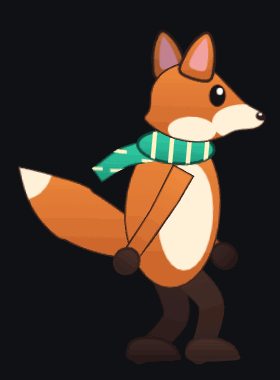

# Bone 2D

[English](README.md) · **Русский**

<p align="center"></p>

 

**Редактор 2D-скелетной анимации, который работает в браузере.** Откройте ссылку, риггуйте, анимируйте, экспортируйте. Ничего ставить не нужно, а ваши файлы не покидают ваш компьютер.
Открытый код (MIT), в духе Spine. Пишет формат **Spine 4.3** (`.json` или бинарный `.skel`, `.atlas`, `.png`), а результат сверяется с официальным рантаймом `spine-core`.

**[Открыть редактор →](https://iamgatz.github.io/Bone-2D/)** Демо-риг «Kit» открывается одним щелчком.
Прямые ссылки: [`?demo`](https://iamgatz.github.io/Bone-2D/?demo) открывает лису, [`?demo=wave`](https://iamgatz.github.io/Bone-2D/?demo=wave) открывает её с играющей анимацией `wave` (есть ещё `walk`, `jump`, `idle`). Интерфейс на русском и английском.
При первом открытии демо двухминутный интерактивный урок («Оживите лису») проведёт по главному циклу работы; из справки его можно запустить снова, а в меню «Обучение» всего семь уроков (риг, сетка, IK, кривые, скины и события, экспорт).

## Возможности

- **Риггинг:** кости, слоты, меши с весами (автотрассировка, кисть весов), скины, clipping, bounding box, пути, импорт из Photoshop.
- **Констрейнты:** IK, transform, path, physics и слайдеры Spine 4.3.
- **Анимация:** dopesheet и график с кривыми Безье, onion skin, события, ключи порядка отрисовки и sequence, библиотека поз, инструменты ключей.
- **Экспорт:** Spine 4.3 JSON или бинарный с упаковщиком атласа; GIF, PNG-последовательность или видео анимации; страница-плеер одним файлом. Импорт Spine JSON 4.0 – 4.3 и бинарного 4.3.
- **Ревью:** отправьте одну HTML-страницу с анимацией; рецензент щёлкает кость и оставляет комментарий, который вы импортируете обратно маркером.
- **Можно экспериментировать:** 300 шагов отмены, контрольные точки, с которыми можно сравнить и взять из них нужное, автоматические резервные копии.
- **Без аккаунта и сервера:** есть и командная строка (`npm run cli`).

В редакторе `Ctrl+K` открывает палитру команд. Что есть у Spine и у Bone 2D, строка за строкой: [docs/SPINE_PARITY.md](docs/SPINE_PARITY.md).

## Запуск локально

```bash
npm install
npm run dev        # http://localhost:5273
npm test           # unit-тесты и случайные сессии редактора, включая сравнение с официальным spine-core
npm run build      # production-сборка в dist/
npm run cli -- help   # данные скелета Spine без редактора: export, import, info, check, clean
```

Длинный прогон случайных сессий (`FUZZ_FROM` — с какого seed начать):

```powershell
$env:FUZZ_SEEDS='300'; $env:FUZZ_STEPS='100'; npx vitest run tests/fuzz.test.ts
```

## Почему экспорту можно доверять

- **Дифф-тесты.** `tests/spine-parity.test.ts` экспортирует «злой» риг (все режимы наследования, shear, IK, transform-, path- и physics-констрейнты, взвешенные меши, деформации, скины, случайные порядки отрисовки), загружает его официальным `@esotericsoftware/spine-core@4.3` и сравнивает мировые матрицы всех костей, вершины мешей, цвета, attachment’ы и порядок отрисовки с нашим солвером в десятках моментов времени. Тесты-«мутанты» подтверждают, что любое расхождение ловится.
- **Случайные сессии.** `tests/fuzz.test.ts` проигрывает сотни последовательностей настоящих действий редактора. После каждого шага документ должен быть корректным, а экспорт должен грузиться официальным рантаймом; в конце солверы сверяются, «undo всё» возвращает исходный документ, «redo всё» — итоговый.

## Устройство проекта

```
src/core      чистая логика без DOM: модель, кривые, солвер (поза, IK, констрейнты, скиннинг), анимация, меши, проверка, экспорт / импорт
src/store     документ на immer-патчах (undo / redo), UI-стор, действия, которые вызывает интерфейс
src/render    WebGL2-рендерер (батчи, blend-режимы, двухцветный тинт, stencil-клиппинг)
src/editor    React-панели, viewport, dopesheet и график, горячие клавиши
src/player    страница, которую открывает рецензент
tests, e2e    vitest (unit, дифф-тесты, случайные сессии) и дымовые тесты Playwright
docs          архитектура, сравнение со Spine, журнал разработки
```

Стек: TypeScript (strict), Vite, React 19, immer, delaunator, собственный WebGL2-рендерер. Карта для разработчиков — [docs/ARCHITECTURE.md](docs/ARCHITECTURE.md) (на английском).

## Горячие клавиши

`V` выбор · `B` кость · `T` `R` `S` перенос / поворот / масштаб · `M` меш · `W` веса · `I` IK · `C` clipping · `Tab` Setup ⇄ Animate · `Space` плей · `K` ключ · `Ctrl+Z` / `Ctrl+Y` undo / redo · `Ctrl+S` / `Ctrl+O` / `Ctrl+E` сохранить / открыть / экспорт · `F12` настройки.
Работают и на нелатинских раскладках; любую можно переназначить в настройках.

## Не сделано

- Веса и деформации для clipping и bounding box (работает только перенос их вершин).
- Бинарные файлы Spine 4.0 – 4.2 не читаются (JSON этих версий читается).
- Совместная работа в реальном времени (делиться можно файлом проекта и страницей ревью).
- Не планируем: полигональную упаковку атласа, ninepatch, JPG-страницы атласа, импорт `.spine`, плагины внешних редакторов.

## Участие в разработке

Issues и pull request’ы приветствуются; самое полезное — сообщение об ошибке с файлом проекта. См. [CONTRIBUTING.md](CONTRIBUTING.md) (на английском) и [SECURITY.md](SECURITY.md).

## Примечания

Bone 2D — независимый проект. Он не связан с Esoteric Software; «Spine» — их продукт и торговая марка, здесь упоминается только чтобы назвать формат файлов, который Bone 2D читает и пишет. Использование официальных рантаймов Spine в игре регулируется их собственной лицензией.

## Лицензия

[MIT](LICENSE)
